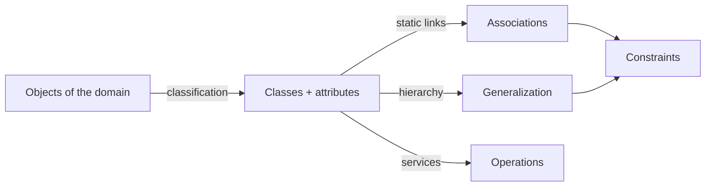

Chapter 3 — UNamur, AMSI 2026-2027 (UML 2.5.1, OMG, Dec. 2017). Running example : an **online sport shop** (catalogue, items, warehouses in Brussels and Namur, customers, orders).

## 1. Overview
- [[Class Diagram]] : static structure of the IS ; origins ER, OMT, OO programming ; analysis vs design use

## 2. Object-oriented modelling
- [[Object]] : identity, lifespan, state, relevance in the domain
- [[Classification]] : group objects with common relevant characteristics ; depends on purpose and granularity

## 3. Classes and attributes
- [[Class]] : set of objects ; name, attributes, operations compartments
- [[Attribute]] : `[vis] name [: type] [mult] [= init] [{constr}]` ; instance vs class attribute
- [[Visibility]] : `+` public, `-` private, `#` protected, `~` package

## 4. Associations and relationships
- [[Association]] : named link between classes, reading direction, roles
- [[Multiplicity]] : `1`, `0..1`, `1..*`, `*` ; one-to-one, one-to-many, many-to-many ; UML vs ER
- [[N-ary Association]] : more than two classes, confusing multiplicities
- [[Aggregation and Composition]] : whole / part ; composition = part dies with the whole
- [[Association Class]] : association with its own attributes
- [[Generalization]] : subclass ⊆ superclass, inheritance, multiple inheritance
- [[Generalization Set Constraints]] : complete / incomplete, disjoint / overlapping, partition
- [[Abstract Class]] : no direct instances ; abstract operations

## 5. Constraints
- [[UML Constraint]] : `{…}` in natural language or OCL ; identifier, role exclusion, `{readOnly}`

## 6. Operations
- [[Operation]] : service offered by the instances ; operation vs method, instance vs static

## Analysis vs design

| | Analysis model | Design model |
|---|---|---|
| A class is | a concept of the application domain | a software element to implement |
| Operations | optional, must have a domain meaning | represent services / behaviour |
| Visibility | irrelevant | relevant |
| Goal | understand the problem | specify the software, generate skeletons |

Same notation, different model intent.

## Relationships at a glance

| Relationship | Meaning | Notation |
|---|---|---|
| Association | objects are linked | plain line |
| Aggregation | whole / part, weak | empty diamond on the whole |
| Composition | whole / part, part dies with the whole | filled diamond on the whole |
| Generalization | "is a", set inclusion | empty triangle on the superclass |

## Review questions
- What makes something an object rather than a property? → [[Object]] (identity, lifespan, state, meaning in the domain)
- Can two analysts produce different valid class diagrams for the same domain? → [[Classification]] (yes : it depends on purpose and granularity)
- Read `Customer "1" — places — "1..*" Order` in both directions. → [[Association]] (a customer places at least one order ; an order is placed by exactly one customer)
- What is the default multiplicity of an attribute? → [[Attribute]] (`[1]` : mandatory and single-valued)
- Why are n-ary associations often avoided? → [[N-ary Association]] (multiplicity semantics is confusing and does not map onto ER)
- What happens to the parts when a composite is deleted? → [[Aggregation and Composition]] (they are deleted too, unless detached before)
- When do you need an association class? → [[Association Class]] (when an attribute belongs to the link, not to either class)
- What is the default for a generalization set? → [[Generalization Set Constraints]] (incomplete and overlapping)
- Is a class with one abstract operation instantiable? → [[Abstract Class]] (no : it is abstract)
- What is the difference between an operation and a method? → [[Operation]] (the operation is the declared service ; the method is its implementation)
