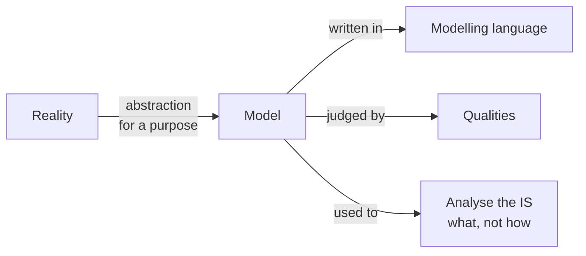

Chapter 1 — UNamur, AMSI 2026-2027. Modelling = **understanding and communicating efficiently through models**, not drawing, writing documentation for the boss or blindly sticking to conventions.

## 1. Modelling
- [[Model]] : cost-effective use of something in place of something else for a **cognitive purpose** ; simpler, safer, cheaper than reality

## 2. Information systems
- [[Information System]] : hardware + software + networks that people use to collect, create and distribute data in organisations ; conceptual model = abstract IS representation

## 3. Modelling languages
- [[Modelling Languages]] : natural language → ad-hoc → semi-formal → formal ; more formal = more automation, harder to read
- [[Natural Language Deadly Sins]] : ambiguity, noise, silence, overspecification, contradiction, forward reference, remorse

## 4. Model qualities
- [[Model Qualities]] : abstract, understandable, precise, predictive, inexpensive ; *all models are wrong, but some are useful*

## 5. Business and functional analysis
- [[Learning from Models]] : build, inspect, formally analyse, experiment
- [[IS Analysis]] : the problem (what, why) before the solution (how) ; analysis errors are the most frequent and most expensive

## Review questions
- What is a model, and what makes it different from a drawing? → [[Model]] (simplification of reality that keeps its essence, for a given purpose and context)
- Why is natural language risky in a specification? → [[Natural Language Deadly Sins]] (ambiguity, silence, contradiction…)
- What do semi-formal notations add over ad-hoc ones? → [[Modelling Languages]] (well-defined syntax, common partial interpretation, partial automation)
- Can a formal model be imprecise? → [[Model Qualities]] (yes : unambiguous but incorrect, e.g. "every bird flies")
- Give the four ways to learn from a model. → [[Learning from Models]] (build, inspect, formally analyse, experiment)
- Why invest in analysis rather than coding straight away? → [[IS Analysis]] (analysis errors are the most frequent, hardest and most expensive to fix : 25-45 % of project costs)
