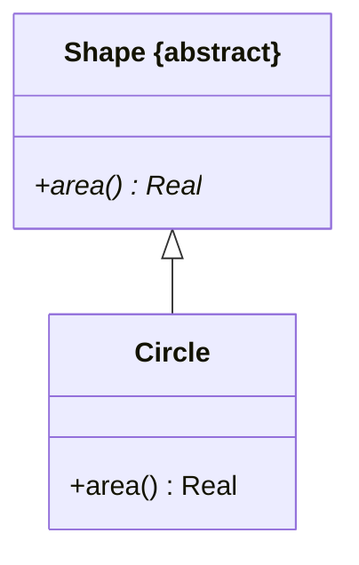

**Abstract class** : a [[Class|class]] that **cannot have direct instances** (only instances of its subclasses) ; a **concrete class** may have direct instances. Name written in *italics* or with `{abstract}` ; the concept comes from programming (`abstract` in Java).

## Abstract vs concrete operations
- **concrete operation** : has an associated **method** (implementation)
- **abstract operation** : declared without method in this class, implemented by the subclass(es) ; written in *italics*
- any class declaring **at least one abstract operation is abstract**

A class should **not** provide a method for an operation
- if the operation is abstract
- or if the method inherited from the superclass is enough

## Abstract class vs complete generalization
An abstract superclass and a [[Generalization Set Constraints|complete]] generalization tell a similar story : every object is in a subclass. Abstract is the software-side view, complete the set-side view.

**Links** : [[Generalization]] [[Operation]]
