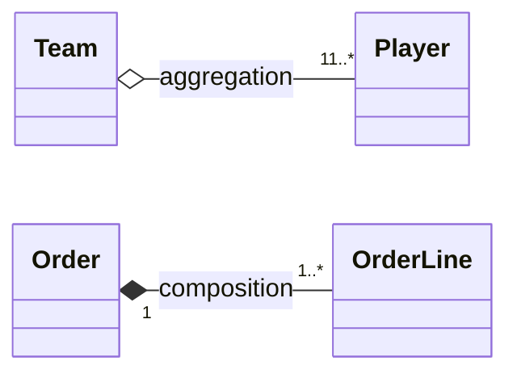

**Aggregation** : a kind of [[Association|association]] where an instance of one class (the **aggregate / compound**) is seen as made of instances of another (the **components**). **Composition** : a **strong** aggregation where the part **cannot exist without** the whole.

## Aggregation (shared aggregation)
- empty diamond on the aggregate side
- semantics **not well defined** : read it as a simple **annotation**

## Composition
- filled diamond on the composite side
- the composite's multiplicity is **at most 1** (`1` or `0..1`)
- the composite is responsible for the **existence and storage** of its parts
- a part belongs to **at most one composite at a time**
- deleting the composite **deletes its current parts**
- a part may be **detached** before deletion and then keep existing

## Aggregation vs composition

| | Aggregation | Composition |
|---|---|---|
| Diamond | empty | filled |
| Part shared? | possibly | at most one whole at a time |
| Whole multiplicity | any | ≤ 1 |
| Deleting the whole | no effect defined | deletes the parts |
| Semantics | annotation | well defined |

**Links** : [[Multiplicity]] [[Generalization]] [[Class Diagram]]
