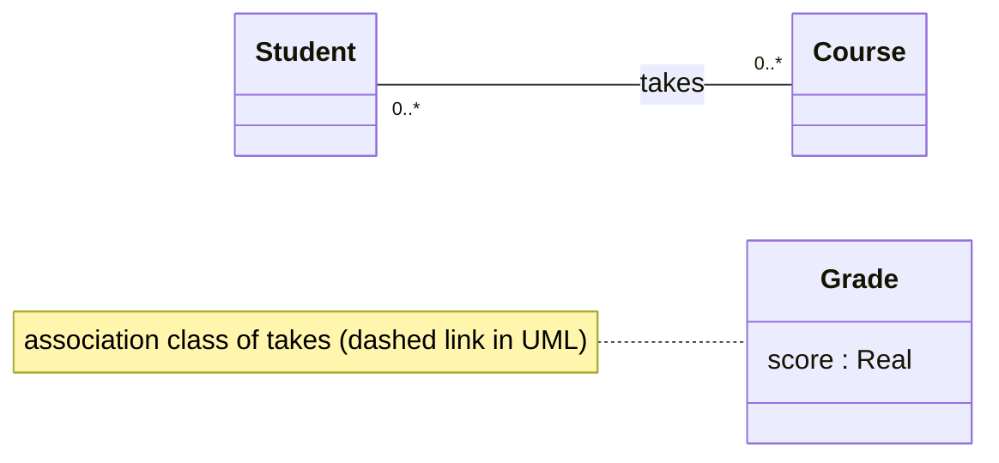

**Association class** : an [[Association|association]] **reified** as a class so it can carry **attributes** ; drawn as a class box joined to the association line by a dashed line.

- **same name** as the association
- **no multiplicity** : implicitly one association-class instance per association instance (per linked pair)
- use it when an attribute belongs to the **link**, not to either class (a grade belongs to a student *in* a course)
- also works with [[N-ary Association|n-ary associations]]

**Links** : [[Attribute]] [[Class]]
