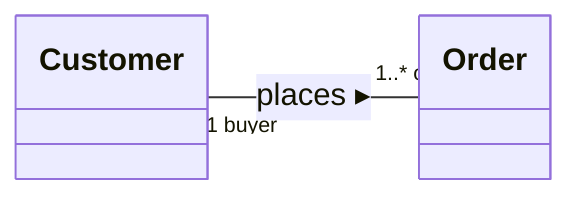

**Association** : a relationship stating that objects of one [[Class|class]] can be **linked** to objects of another ; drawn as a line, with a **name** and a **reading direction** (both optional but recommended).

- UML relationship types : **association**, [[Aggregation and Composition|aggregation and composition]], [[Generalization|generalization / specialization]], dependencies
- relationships link and structure concepts, and organise the classification in a hierarchy

## Roles
- each **end** of the association is a **role**
- a role can have a **name** and a [[Visibility|visibility]]
- each role has a [[Multiplicity|multiplicity]]

## Reading an association
With the association name (source and target given by the reading direction) :
- *source class – name – target multiplicity – target class* → "A customer **places** at least one order."

With role names :
- *source class – has for – target role – target multiplicity – target class* → "An order **has for buyer** a single customer", "A customer **has for order** one or more orders."

**Links** : [[N-ary Association]] [[Association Class]] [[Class Diagram]]
