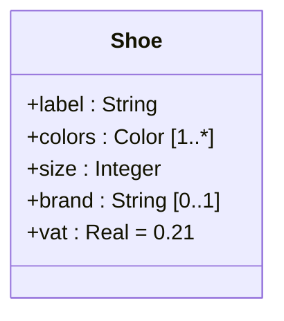

**Attribute** : a named characteristic of the objects of a [[Class]], written `[vis] name [: type] [mult] [= init value] [{constraint}]` ; only the **name** is mandatory.

| Part | Rule |
|---|---|
| **Visibility** | `+ - # ~`, see [[Visibility]] |
| **Type** (optional) | base type (`Integer`, `String`…), a user-defined type (any class), or an **enumeration** |
| **Multiplicity** (optional) | `[min..max]` : `[1..5]`, `[3]`, `[0..*]` ; default `[1]` = `[1..1]` |
| **Initial value** (optional) | `= value` |
| **Constraint** (optional) | `{readOnly}` ; attributes are modifiable by default |

- `min = 0` → **optional** attribute ; `max > 1` → **multivalued** attribute
- default : **mandatory and single-valued**

## Instance vs class attribute
- **instance attribute** (default) : its value evolves **independently for each object**
- **class attribute** (name **underlined**) : **one value shared by all instances** (`static` in Java)

**Links** : [[Multiplicity]] [[Operation]] [[UML Constraint]]
