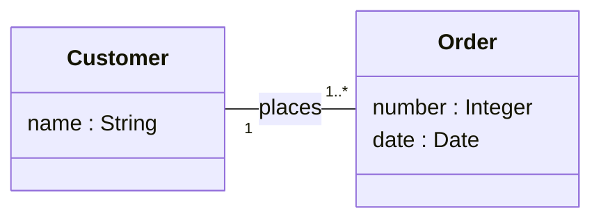

**Class diagram** : a UML diagram that specifies the **static (structural)** characteristics of the (software or non-software) elements of the IS.

- origins : **Entity-Relationship** (Chen), **OMT** (Rumbaugh), OO programming (Java, C++)
- main constructs : packages, [[Class|classes]], [[Attribute|attributes]], [[Association|associations]], [[Operation|operations]]

## Analysis vs design use
The **purpose** decides which constructs are appropriate, which best practices apply and even, partly, the semantics.

| Analysis | Design |
|---|---|
| describes the concepts of the **application domain** | specifies the **software** |
| developed in parallel with use cases | includes operations / methods |
| no operations or software-specific constructs | can drive **class-skeleton generation** |

Two rules in every case : **maintain traceability** between models and **define the terms in the glossary**.

## Qualities and limitations
- **understandable** when it stays small and focused, uses advanced constructs sparingly, defines its terms and states its intent ; large diagrams quickly become unreadable ; helped by examples, scenarios, natural-language explanations, validation with domain experts
- **abstraction** : one of its main strengths, from domain concepts down to software design
- **precise** : more than sketches or natural language thanks to [[Multiplicity|multiplicities]], [[Generalization|generalization]] and [[UML Constraint|constraints]] ; some constructs are intentionally loose, OCL can add precision
- **predictive / automation** : code generation, reverse engineering, model transformations, consistency checking, OCL constraint verification
- **cost** : offset by documentation, communication, code skeletons and reuse

## Take-away
- models the **static structure** of a system or domain
- meaning depends on the **purpose** : analysis or design
- core : classes, attributes, associations, multiplicities, generalization
- good models are **selective** : model only what is relevant
- combine with behavioural models and constraints when needed

**Links** : [[UML Diagrams]] [[Object]] [[Classification]] [[IS Analysis]]
