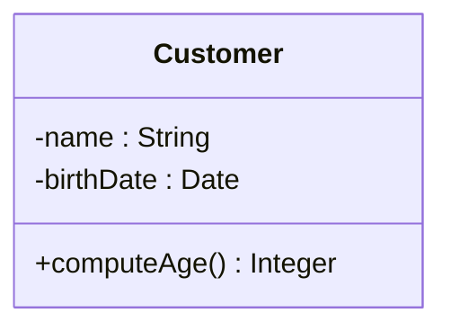

**Class** : the concept of a kind of object, i.e. **the set of all objects** with common relevant characteristics (class `Dog` = the concept of dog = the set of all dogs ; `Sultan` is an [[Object|object]], an instance of it).

A class is drawn as a box with **three compartments** :

| Compartment | Syntax |
|---|---|
| **Name** | `Customer` |
| **Attributes** | `[vis] name [: type] [mult] [= init] [{constr}]` → [[Attribute]] |
| **Operations** | `[vis] op([par :] type, …) [: type]` → [[Operation]] |

- every class defines a new **type**, usable as an attribute or parameter type
- extra compartments and extension mechanisms (stereotypes) exist

## What a class represents

| | In analysis | In design |
|---|---|---|
| Without operations | a **domain concept** (dog), visibility irrelevant | a software element, data store, relational table |
| With operations | an **existing software component** offering services | a **software component to build** |

Same notation, different model intent (see [[Class Diagram]]).

**Links** : [[Classification]] [[Visibility]] [[Abstract Class]] [[Generalization]]
