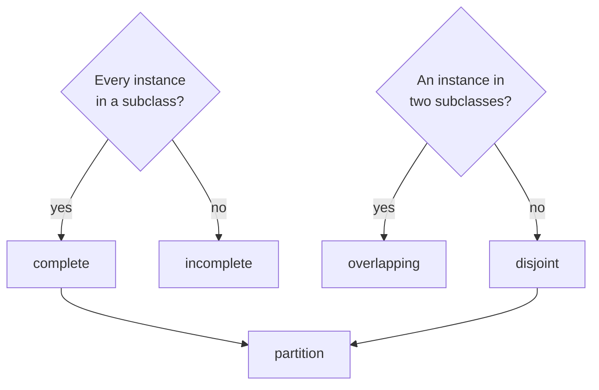

**Generalization set constraints** : two properties of the set of subclasses of a [[Generalization|generalization]] : **complete / incomplete** (does every instance belong to a subclass?) and **disjoint / overlapping** (can an instance belong to several subclasses?). Written `{complete, disjoint}` near the arrows.

| Constraint | Definition | Example |
|---|---|---|
| **Complete** | every superclass instance is also an instance of **some** subclass | comic `Drawer` → `Cartoonist`, `Scenarist`, `Dialog Writer`, `Colorist` |
| **Incomplete** | at least one superclass instance is in **no** subclass | `Athlete` → `Cyclist`, `Runner`, `Swimmer` (there are other athletes) |
| **Overlapping** | at least one instance is in **two or more** subclasses | a triathlete is cyclist, runner and swimmer |
| **Disjoint** | no instance is in more than one subclass | UNamur staff : `Assistant`, `Professor`, `Administrative Staff Member` |

- **complete + disjoint = partition** : every instance is in exactly one subclass (menu entry → starter, main course, dessert)
- **default** : **incomplete and overlapping**

**Links** : [[Generalization]] [[UML Constraint]] [[Abstract Class]]
