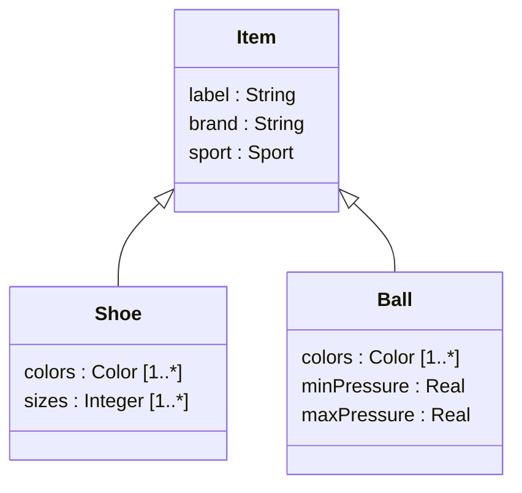

**Generalization / specialization** : a **hierarchical** relationship between a more general **superclass** and more specific **subclasses** ; it puts several abstraction and granularity levels into one model.

- **set inclusion semantics** : class = set of relevant objects, subclass = **subset** of the superclass → every instance of `Shoe` is also an `Item`
- subclasses **inherit** the attributes, associations and operations of the superclass (all items can be stored and ordered)
- empty triangle arrow pointing to the superclass

## Why specialize, why generalize
- **specialization** : add **specific features** to the subclass, focus on its specific aspects (balls also have a min and max pressure)
- **generalization** : **factor out** common elements, give a more generic description, hide the details of the subclasses (`Item` keeps that all items can be stored and ordered and have a label, a brand and a sport, without listing the categories)

## Multiple inheritance
- a class may have **several superclasses** (a `Triathlete` is a `Cyclist`, a `Runner` and a `Swimmer`)
- UML syntax does not enforce it, but the parent generalization set usually needs to be **overlapping** (see [[Generalization Set Constraints]])

**Links** : [[Abstract Class]] [[Classification]] [[Visibility]]
