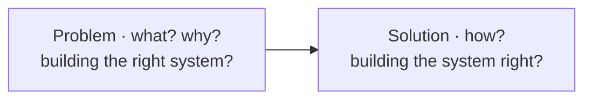

**IS analysis** : the phase of the IS lifecycle that defines the **problem** (**what** the system should do and **why**) before the **solution** (**how**) ; it is the scope of this course.

- **analysis** answers *building the right system?* (validation) ; **design and implementation** answer *building the system right?* (verification)
- the requirements specification states **what** (vs how) the system should do to meet the **organisation's objectives**
- models are the **main means of communication** between stakeholders : customers, users and domain experts on one side, analyst in the middle, developers on the other

## Why analysis matters
- common sense : if we cannot identify and communicate precisely the problem the IS must solve, there is little chance of solving it
- *the most fundamental quality of software is its compliance with the requirements*
- analysis errors are
  - the **most frequent**
  - the **hardest** and **most expensive** to fix
  - the **first cause of failure** of IS projects
  - **25-45 %** of total project costs to fix

**Links** : [[Information System]] [[Natural Language Deadly Sins]] [[Class Diagram]] [[UML Usage Styles]]
