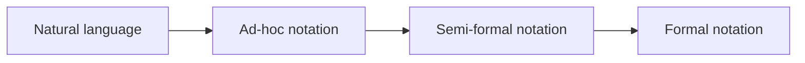

**Modelling language** : the notation a model is written in ; IS descriptions range from **informal** (natural language, ad-hoc) to **formal**, trading readability for precision and automation.

- **syntax** = how the model is written ; **semantics** = what it means (its interpretation)
- [[UML]] is the course's semi-formal language ; OCL adds formal constraints on top

## Natural language
*"Customers buy books. A book has a title, author, ISBN…"*
- no need to learn (if every term is well understood), accessible to **all stakeholders**
- but **verbose** and exposed to the [[Natural Language Deadly Sins]]

## Ad-hoc notations
Boxes and arrows invented on the spot.
- no need to learn (if every symbol is well understood)
- **no well-defined syntax**, **no common interpretation** → risk of ambiguity

## Semi-formal notations
- **well-defined syntax**, usually visual
- **common partial interpretation**
- partial automation : reasoning and generation
- short learning curve
- ambiguities remain possible

## Formal notations
- well-defined syntax and **mathematically sound** interpretation
- greater automation : reasoning and generation
- **hard to read**, long learning curve

## Comparison

| | Natural | Ad-hoc | Semi-formal | Formal |
|---|---|---|---|---|
| Learning cost | none | none | short | long |
| Syntax | — | not defined | well defined | well defined |
| Semantics | ambiguous | no common one | partial | mathematical |
| Automation | none | none | partial | high |
| Readability | all stakeholders | variable | good | hard |

**Links** : [[Model]] [[Model Qualities]] [[Information System]]
