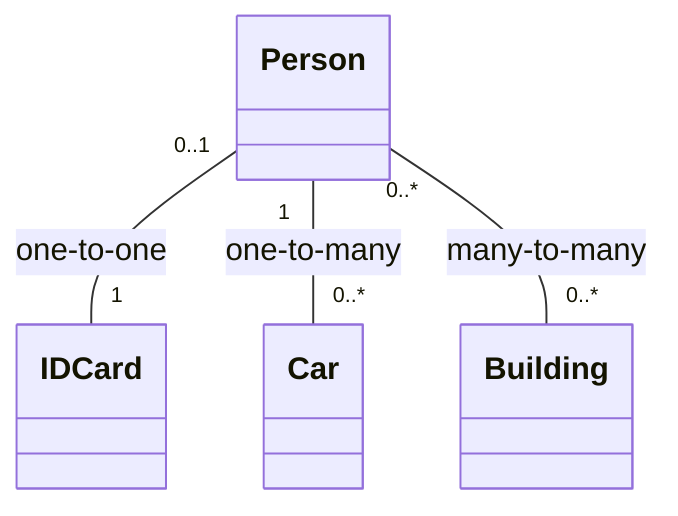

**Multiplicity** : on each role of an [[Association|association]], the number of instances of that class that **one instance of the other class** must be linked to.

| Form | Meaning | Examples |
|---|---|---|
| `x` (= `x..x`, x > 0) | exactly x | `1`, `3` |
| `x..y` (y > x ≥ 0) | at least x, at most y ; x = 0 → **optional** role | `0..1`, `2..5` |
| `x..*` (x ≥ 0) | at least x | `*` (= `0..*`), `1..*` |
| `x, y, …, z` | one of the listed values ; combinable (`1..3,5`) | **invalid in UML 2.5.1** |

- `1` is the default but **always write it**
- the multiplicity is written on the **far end** : `Customer "1" -- "1..*" Order` means one customer has 1..* orders

## Typical patterns

## UML multiplicities vs ER cardinalities
The two notations are written on **opposite sides** : a person owns 0 to N cars, a car is owned by at most one person.

| | Next to Person | Next to Car |
|---|---|---|
| UML multiplicity | `0..1` | `0..*` |
| ER cardinality | `0-N` | `0-1` |

**Links** : [[Attribute]] [[N-ary Association]] [[UML Constraint]]
