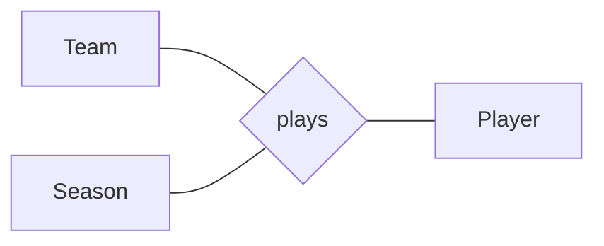

**N-ary association** : an [[Association|association]] between **more than two** classes, drawn as a **diamond** linked to each class.

- the multiplicity of a role constrains the number of instances of that class for **each combination of the other N−1 instances**
- example (Team, Season, Player) :
  - for a given season, a given team has **0 or at least 11** players
  - for a given season, a given player plays in **at most one** team
  - a given player plays in a given team for **any number** of seasons

## Pitfalls
- the semantics of multiplicities is **confusing**
- the mapping with ER cardinalities is **lost** (see [[Multiplicity]], [Hainaut 22])
- some authors only use the maximum ; others advise **avoiding** n-ary associations
- not allowed with aggregation / composition or qualifiers
- an n-ary association can still carry an [[Association Class|association class]]

**Links** : [[Association]] [[Multiplicity]]
