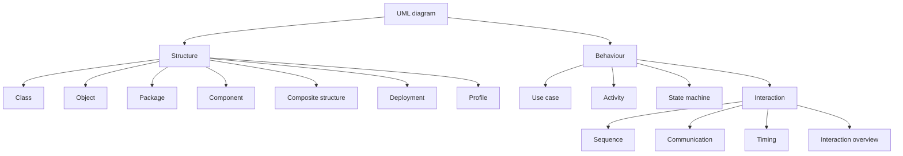

**UML diagrams** : the 14 diagram types of UML 2.5, split into **structure diagrams** (what the system is made of) and **behaviour diagrams** (what it does).

- the course focuses on **class**, **state machine**, **activity** and **use case** diagrams, plus OCL constraints
- [[Class Diagram]] : static structure ; object diagrams show concrete instances of it (see [[Object]])
- UML covers both **structural and behavioural** modelling, which is one of its strengths ; keeping all these views **consistent** is one of its costs

**Links** : [[UML]] [[UML Usage Styles]]
