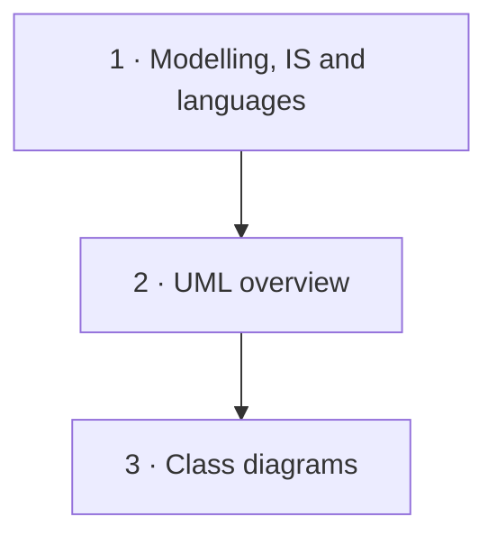

## Course map

## Key concepts
**Modelling** : [[Model]] · [[Information System]] · [[Modelling Languages]] · [[Model Qualities]] · [[IS Analysis]]

**UML** : [[UML]] · [[UML Diagrams]] · [[UML Usage Styles]]

**Structure** : [[Class Diagram]] · [[Object]] · [[Class]] · [[Attribute]] · [[Association]] · [[Multiplicity]]

**Hierarchies and parts** : [[Generalization]] · [[Generalization Set Constraints]] · [[Aggregation and Composition]] · [[Abstract Class]]
