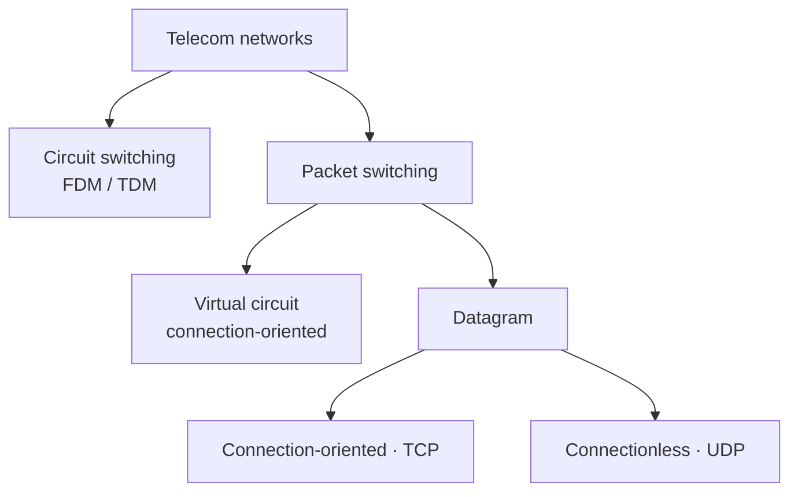

## Outline
1. What is the Internet?
2. Network edge
3. Network core
4. Network access and physical media
5. Internet structure and ISPs
6. Delay and packet loss
7. Protocol layers, service models
8. History

---
## 1. What is the Internet?
- [[What is the Internet]] : *nuts and bolts* view (devices, links, routers, protocols, network of networks) + *service* view
- [[What is a Protocol]] : format + order of messages + actions on transmission/receipt
- Original assumptions (1960s) : [[Best Effort]], mutual trust, wired networks, E2E paradigm
	- no longer true in the 21st century → research (security, middleboxes) slowed down by **ossification**
	- Road ahead : virtualisation (SDN, NFV), protocols moved to user space
- Structure : **edge** (end systems) / **core** (routers) / **access** (physical links)

## 2. Network edge
- [[The Network edge]]
	- End systems : client/server vs P2P model
	- Connection-oriented (TCP) vs connectionless (UDP)

## 3. Network core
### Two fundamental approaches
| | [[Circuit Switching]] | [[Packet Switching]] |
|---|---|---|
| Resources | reserved (dedicated) | shared, used on demand |
| Guarantee | yes (at the cost of resource waste) | no → [[Best Effort]] |
| Link sharing | [[Frequency Division Multiplexing\|FDM]] / [[Time Division Multiplexing\|TDM]] | [[Statistical Multiplexing]] |
| Example | PSTN, MPLS | Internet |

- **PS vs CS** (2 Gbps link, user at 200 Mbps active 10 % of the time) : CS → 10 users, PS → ~35 users for the same delay ⇒ ×3
- **Message vs packet switching** : splitting into packets = *pipelining* (parallel transmission) → much shorter delay (15 s → 5.002 s)

### Packet forwarding (2 classes)
- [[Datagram networks]] : destination address → next hop, no state in routers
- [[Virtual Circuit networks]] : VC ID → next hop, path fixed at setup, per-session state

### Network taxonomy (3 axes)

1. Circuit switching vs packet switching
2. Datagram vs virtual circuit
3. Connection-oriented vs connectionless

---
## 4. Network access and physical media
- [[Network Access]] : link end system → edge router, 3 categories
	- Residential : dial-up (legacy) → broadband : [[xDSL]] (phone line), [[Hybrid Fiber Coax|HFC]] (cable TV, shared), [[Fiber To The x|FTTx]] (fiber, PON)
	- Institutional : [[Local Area Network|LAN]] (Ethernet)
	- Mobile : [[Wireless access networks]] (WiFi, 2G → 5G)
- [[Physical Media]] : guided (twisted pair, coax, fiber) vs unguided (radio, satellite GEO/LEO)

| Access | Medium | Shared? | Multiplexing |
|---|---|---|---|
| xDSL | twisted pair | no (dedicated up to DSLAM) | FDM |
| HFC | fiber + coax | yes | FDM |
| FTTH / PON | fiber | yes (splitters) | WDM |
| WiFi / cellular | radio | yes | — |

## 5. Internet structure and ISPs
- [[ISP Hierarchy]] : Tier 1 (peering) → Tier 2 (customer) → Tier 3 / local (access)
- Today : flatter Internet → IXPs + CDNs

## 6. Delay and packet loss
- [[Nodal Delay]] : processing + queueing + transmission (L/R) + propagation (d/s)
- [[Queueing Delay]] : traffic intensity La/R, must stay < 1
- [[Packet Loss]] : full buffer → drop
- [[Traceroute]] : measure real delays hop by hop (TTL + ICMP)

## 7. Protocol layers, service models
- [[Protocol Layering]] : each layer = a service built on the layer below, encapsulation (header added per layer)
- [[Internet Protocol Stack]] (5 layers) vs [[OSI Model]] (7 layers)
- Layers vs planes : data / control / O&M
- Evolutions : [[Software Defined Networking|SDN]], [[Network Function Virtualisation|NFV]]

## 8. History
- [[Internet History]] : ARPAnet (1969) → Cerf & Kahn principles (1974) → TCP/IP (1983) → Web (90s) → cloud, SDN/NFV

---
## Review questions
- Flow control vs congestion control? → [[The Network edge]]
- How does connection-oriented service provide reliable transport? → [[The Network edge]]
- Statistical multiplexing vs TDM? → [[Statistical Multiplexing]]
- Pros & cons of message segmentation? → [[Packet Switching]] (pipelining vs header overhead)
- 5 layers of the Internet stack and their roles? → [[Internet Protocol Stack]]
