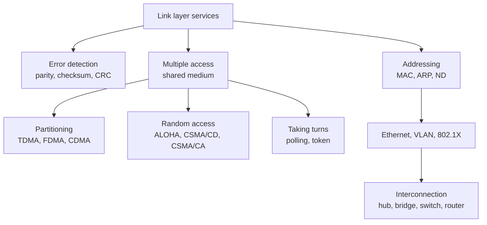

# Link Layer and Local Area Networks
Chapter 6 — L. Schumacher (UNamur), based on Kurose & Ross. Last chapter of the journey down the protocol stack.

## Outline
1. Data link layer services
2. Error detection and correction
3. Multiple access protocols
4. LAN addresses : Neighbour Discovery (IPv6), ARP (IPv4)
5. Ethernet
6. Hubs, bridges, switches and routers

## 1. Data link layer services
Move a frame between **adjacent** nodes. Two sublayers : LLC (framing, addressing) and MAC (medium access). Services like the transport layer (reliability, flow control) but node to node, implemented in the adapter (NIC).
→ [[Link Layer Services]]

## 2. Error detection and correction
Parity (odd errors), 2D parity (corrects one bit = FEC), checksum (weak, software, transport), **CRC** (strong, hardware, link layer).
→ [[Error Detection]]

## 3. Multiple access protocols
Shared broadcast link → collisions. Three families :

| Family | Examples | Note |
|---|---|---|
| Channel partitioning | TDMA, FDMA, CDMA | good at high load |
| Random access | slotted ALOHA (37 %), pure ALOHA (18 %), CSMA/CD, CSMA/CA | good at low load |
| Taking turns | polling, token passing | no collisions, but SPOF |

→ [[Multiple Access Protocols]] · [[CDMA]] · [[Random Access Protocols]] · [[CSMA-CA]]

## 4. LAN addresses
48-bit flat MAC address vs hierarchical IP address. ND (IPv6) and ARP (IPv4) map IP → MAC on the local link. Off-LAN : frame goes to the router's MAC.
→ [[MAC Address and ARP]]

## 5. Ethernet
Dominant LAN : connectionless, unreliable, CRC, CSMA/CD, Manchester encoding, 10 Mbps → 100 Gbps. Extensions : VLANs (802.1Q), access control (802.1X, RADIUS).
→ [[Ethernet]] · [[VLAN]] · [[802.1X and RADIUS]]

## 6. Hubs, bridges, switches and routers
| Device | Layer | Key idea |
|---|---|---|
| Hub | L1 | repeater, one collision domain |
| Bridge / switch | L2 | self-learning, filter / forward / flood, spanning tree |
| Router | L3 | best path, needs configuration |

→ [[Link Layer Switches]]

## Review questions
1. Two nodes start sending a frame of length L at the same time on a channel of rate R, with propagation delay t_prop. Is there a collision if t_prop < L/R? Why? → [[Random Access Protocols]]
   Yes : each node's signal reaches the other after t_prop, while it is still transmitting (L/R > t_prop) → the frames overlap on the medium (and with CSMA/CD both detect it and abort).
2. Would token ring be efficient on a LAN with a very large perimeter? Why? → [[Multiple Access Protocols]]
   No : the token takes a long time to go around, nodes wait (latency) and the channel sits idle.
3. How big are the LAN, IPv4 and IPv6 address spaces? → [[MAC Address and ARP]]

   | Space | Bits | Addresses |
   |---|---|---|
   | MAC | 48 | 2⁴⁸ ≈ 2.8 × 10¹⁴ |
   | IPv4 | 32 | 2³² ≈ 4.3 × 10⁹ |
   | IPv6 | 128 | 2¹²⁸ ≈ 3.4 × 10³⁸ |
4. A 100 Mbps adapter sends an infinite stream of 1s with Manchester encoding. How many transitions per second? → [[Ethernet]]
   One transition in the middle of every bit, plus one at every bit boundary between two 1s → **2 × 10⁸ transitions/s**.
5. What is the difference between a checksum and a CRC? → [[Error Detection]]
6. Why can't WiFi use collision detection, and how does RTS/CTS fix the hidden terminal problem? → [[CSMA-CA]]
7. How does a switch learn its table, and what does it do with an unknown destination? → [[Link Layer Switches]]
8. When should you use a switch, and when a router? → [[Link Layer Switches]]

> Questions 1–4 are from the slides ; the answers and questions 5–8 are mine.

**Links** : [[Network Layer]] [[Computer Networks and the Internet]] [[Network]]
