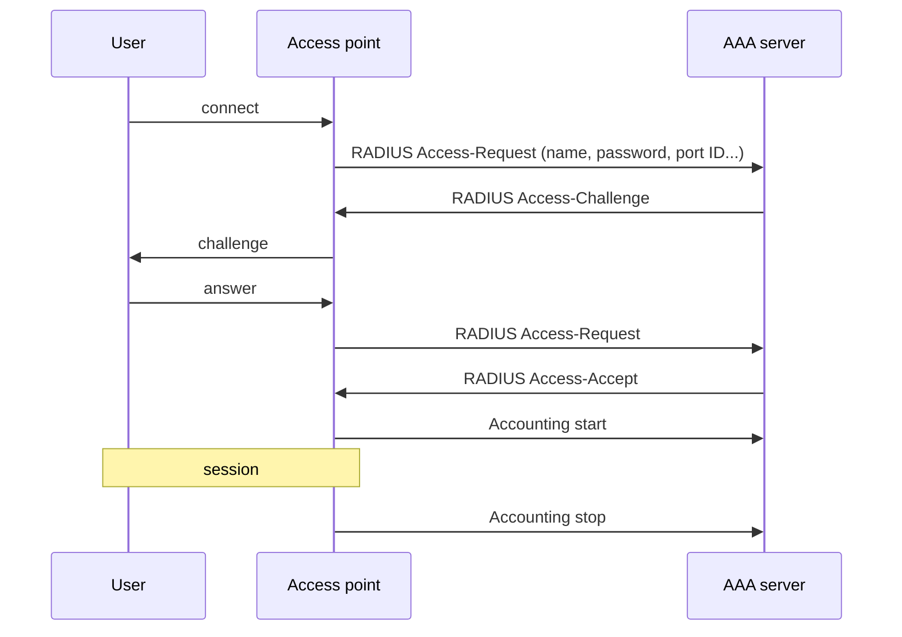

**IEEE 802.1X** = access control on a LAN / WiFi port, using **EAP** (Extensible Authentication Protocol).
Instead of every access point (AP) keeping a list of allowed users, it forwards requests to a central **AAA server** (Authentication, Authorisation, Accounting) using **RADIUS**.

## RADIUS vs Diameter
| | RADIUS | Diameter (RFC 3588) |
|---|---|---|
| Request ID | 8 bits → **256** pending requests | 32 bits → 4.3 × 10⁹ |
| Congestion control | none | yes |
| Transport | (UDP, general knowledge) | **TCP or SCTP** |
| Model | client / server | **P2P**, any node can send requests |
| Security | | IPsec and TLS |

Diameter = planned successor : RADIUS **doesn't scale**.

Real example : **EAP-SIM** (SIM card authentication), Proximus Smart WiFi (2015).

**Links** : [[Ethernet]] [[Wireless access networks]] [[IPsec]] [[HTTPS and TLS]]
