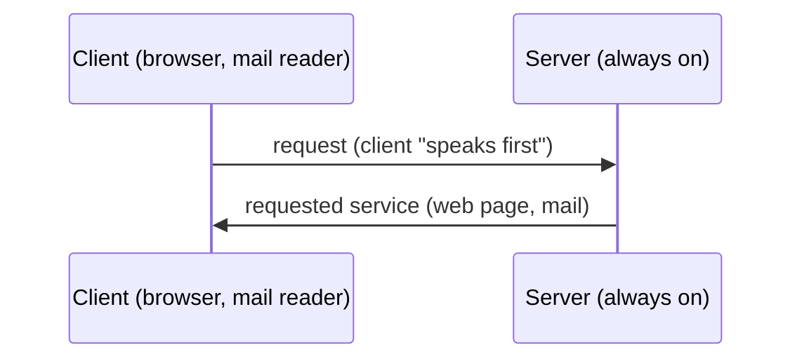

## Jargon
| Term | Meaning | Example |
|---|---|---|
| Process | program running within a host | browser, web server |
| Interprocess communication | 2 processes on the **same** host (defined by the OS) | `du -k -s * \| grep somebody` |
| Application-layer protocol | 2 processes on **different** hosts | HTTP, SMTP |
| User agent | interface between the user "above" and the network "below" | browser, mail reader, media player |

Web application = browser + server + protocol (HTTP) + document format (HTML)

## What a protocol defines
- **Types** of messages (request / response)
- **Syntax** : fields and how they are delineated
- **Semantics** : meaning of the fields
- **Rules** : when and how a process sends / responds

| Public-domain | Proprietary |
|---|---|
| described in RFCs | closed |
| interoperable | usually not interoperable |
| HTTP, SMTP | Skype, KaZaA |

## Client-server paradigm

**Links** : [[Socket]] [[App Transport Requirements]] [[What is a Protocol]] [[The Network edge]]
