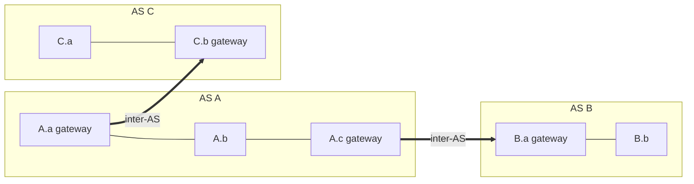

## Why hierarchical routing?
The ideal study assumed identical routers and a "flat" network. Not true :
| Issue | Problem |
|---|---|
| **Scalability** | millions of destinations : can't store them all, table exchanges would swamp the links |
| **Administrative autonomy** | Internet = network of networks, each admin wants to control routing in its own network |

## Autonomous Systems (AS)
- Routers grouped into **regions** = AS
- Inside an AS : same **intra-AS** routing protocol (different ASs may use different ones)
- **Gateway routers** : at the edge of an AS, run intra-AS with routers inside **and** inter-AS with other gateways

## Types of AS
| Type | Description |
|---|---|
| Stub AS | only source / destination of traffic |
| — pure stub | one connection to other ASs |
| — multihomed stub | several connections, but **no transit** |
| Provider AS | connects many ASs together |
| — transit | access to every public destination, **for a fee** |
| — peering | exchange traffic only between the two networks and their customers |

## Two-level routing
| Intra-AS (Interior Gateway Protocol) | Inter-AS (Exterior Gateway Protocol) |
|---|---|
| admin chooses the routing strategy | single standard : [[BGP]] |
| [[RIP]], [[OSPF]], IS-IS | |

## Hot potato routing
A destination outside the AS is reachable through several gateways with equal cost → send to the **closest** gateway (get rid of the packet as fast as possible). Alternative : traffic engineering.

**Links** : [[ISP Hierarchy]] [[Routing Algorithms]] [[BGP]] [[RIP]] [[OSPF]]
