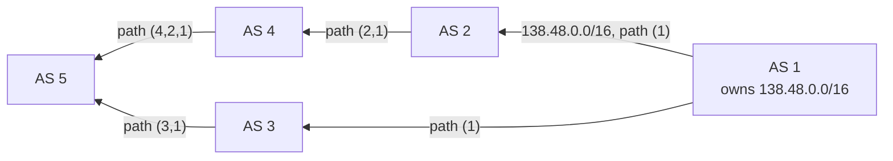

The **de facto standard** for inter-AS routing.
- **Path vector** protocol : like distance vector, but peers exchange the **full list of ASs** to the destination
- BGP peers talk over **TCP port 179**
- **eBGP** between gateways of different ASs, **iBGP** inside an AS to spread what was learnt

## AS path
- Each AS has a 4-byte **ASN** (AS Number) from one of the regional registries (RIR)
- BGP routes to **CIDR prefixes**, not to hosts
- Advertisement = prefix + AS path

AS 5 receives two paths and picks one (e.g. the shorter (3,1)). Seeing its own ASN in a path → reject it = **loop prevention**.

## Policy routing
| Viewpoint | Rule |
|---|---|
| Multihomed stub X (customer of B and C) | X advertises only paths **to itself** → it never carries traffic between B and C |
| Provider B | advertises its route to customer X ; does **not** advertise route BAW to competitor C, since C→W traffic has no source/destination in B's customers (B would carry it for free) |

## BGP hijacking
An AS advertises prefixes it doesn't own (by mistake or on purpose) → traffic is misrouted (e.g. 2018 : US domestic traffic routed through China Telecom).

## Data centers
Spine / leaf / top-of-rack topology. OSPF flooding doesn't scale → BGP used for its **AS-path filtering** : same ASN for S1 and S2 → S2 rejects paths through S1, preventing "valley" paths L10 → S1 → L11 → S2.

## Intra-AS vs inter-AS routing
| | Intra-AS (RIP UDP 520, OSPF) | Inter-AS (BGP TCP 179) |
|---|---|---|
| Policy | one admin, little concern | **policy-based** decisions are key |
| Scalability | too big → split into several ASs | must handle a huge number of networks |
| Performance | focus on **performance** | policy matters more than route quality |

**Links** : [[Autonomous Systems]] [[Route Aggregation]] [[OSPF]] [[RIP]] [[ISP Hierarchy]]
