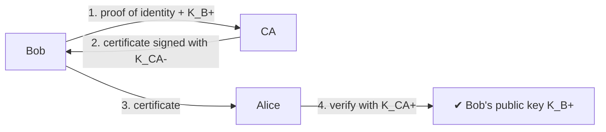
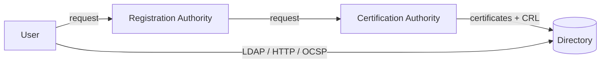

Trusted third party binding a **public key to an identity**.

## Certificate (X.509, ITU-T)
1. Bob gives a proof of identity to the CA
2. The CA creates a certificate binding Bob to $K_B^+$, **digitally signed** with the CA's private key
3. Alice gets Bob's certificate (from Bob or elsewhere) and checks it with the **CA's public key** → Bob's valid public key

## Public Key Infrastructure (PKI)
PKI = authorities (Registration Authority RA + CA) + directory + procedures (creation, update, **revocation**)
- Revocation check : Certificate Revocation Lists (**CRL**) or Online Certificate Status Protocol (**OCSP**)

## Example : Belgian eID
- X.509 certificates stored on the chip
- Only for **authentication and signature**, not encryption

**Links** : [[Person in the middle attack]] [[Public Key Cryptography]] [[Key Distribution Center]]
