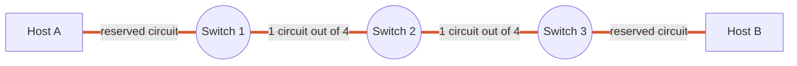

## Approach
- E2E resources along the path are reserved for every ongoing call during the whole duration (dedicated → no sharing)
- Resources are divided into "pieces" (using [[Frequency Division Multiplexing|FDM]] or [[Time Division Multiplexing|TDM]]) and reserved to a specific user
- Guaranteed performance, at the cost of resource waste (an idle piece cannot be shared)
- Examples : PSTN (telephone), MPLS

**Links** : [[Packet Switching]]
