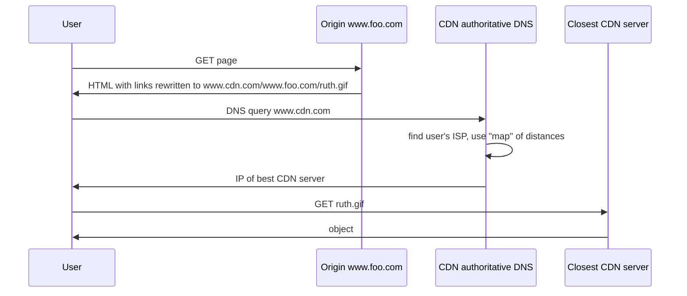

- The **content providers** are the CDN's customers
- The CDN installs hundreds of servers in **lower-tier ISPs**, close to users
- It replicates the customers' content and updates it when the provider changes it

## How a request is redirected (via DNS)

- Origin server distributes the HTML, CDN distributes the files
- Not only web pages : live and stored audio/video, software updates

## Operators (2025)
| CDN | Size |
|---|---|
| Akamai | leader, 365 000+ servers in 130+ countries |
| Cloudflare | 10 %+ of websites |
| Meta (in-house) | CDN sites inside ISPs, split TCP |

**Links** : [[Web Caching]] [[DNS]] [[ISP Hierarchy]]
