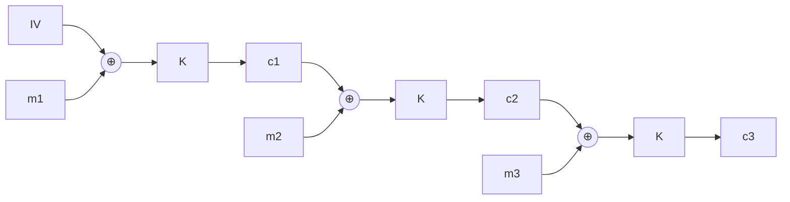

**Data Encryption Standard** : 64-bit plaintext blocks, **56-bit** symmetric key.

## Encryption
1. Initial permutation
2. **16 identical rounds** : swap left/right halves + function using a different **48-bit subkey** (derived from the 56-bit key) → expansion (E-box), substitution, XOR, permutation (P-box)
3. Final permutation
- Decryption = reverse operations

Goal : no correlation between ciphertext and plaintext or key → only exhaustive search works.

## How secure? → broken
| Challenge | Date | Time to crack |
|---|---|---|
| I | Jan 1997 | 96 days |
| II-1 | Feb 1998 | 41 days |
| II-2 | Jul 1998 | 56 h |
| III | Jan 1999 | **22.25 h** |

→ 56-bit key too short.

## 3-DES
Three successive DES encodings → longer effective key.

## Cipher-Block Chaining (CBC)
- Each plaintext block is XORed with the **previous ciphertext block** before encryption : $c_j = K(m_j \oplus c_{j-1})$
- First block uses an **Initialisation Vector (IV)**
- → identical plaintext blocks give different ciphertexts (used in IEEE 802.11i)

**Links** : [[Symmetric Key Cryptography]] [[AES]]
