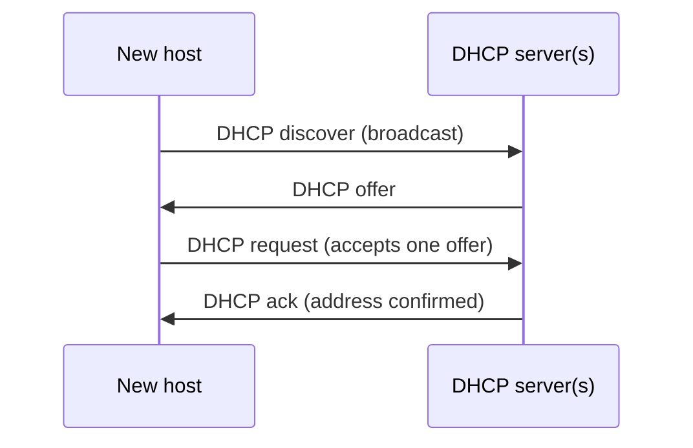

**Application-layer** protocol that gives a host its IP address **dynamically** when it joins a network.
- Reuse of addresses : held only while connected
- **Lease** that can be renewed
- Good for mobile users joining networks

## 4 messages

Encapsulation : DHCP message → UDP segment → IP datagram → link-layer frame.

Several DHCP servers may answer → the host picks one offer (risk : rogue server competing with the real one).

IPv6 equivalent : [[IPv6|SLAAC]] or DHCPv6.

**Links** : [[IP Addressing]] [[NAT]] [[IPv6]]
