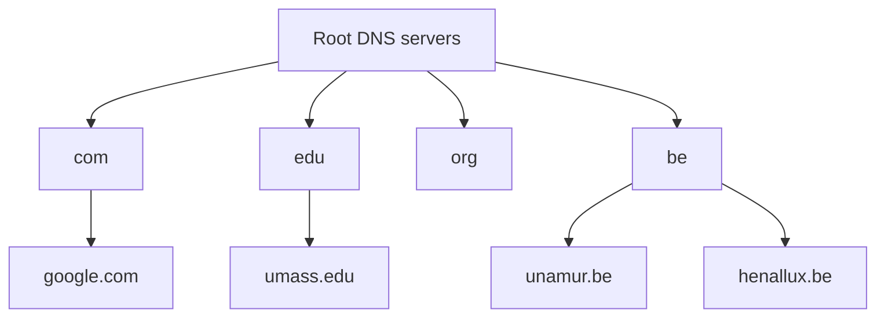
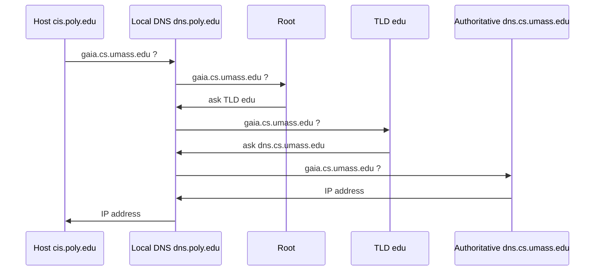

Hosts have 2 identifiers : **hostname** (for humans, `gaia.cs.umass.edu`) and **IP address** (for datagrams). DNS maps one to the other.
- Distributed database, organised in a hierarchy
- Core Internet function, but runs as an **application-layer** protocol (complexity at the edge)
- Port **53** : UDP for queries, TCP for DB updates (implementation : BIND)

## Services
1. Hostname → IP address
2. Host aliasing : `www.foo.com` → canonical `relay1.west-coast.foo.com`
3. Mail server aliasing : `bob@foo.com` → mail server
4. **Load balancing** : several IPs for one name, rotated between queries

## Why not centralised?
Single point of failure, huge traffic, long delays for distant queries, maintenance → **not scalable**. Solution : many servers, hierarchical, distributed worldwide.

## Hierarchy

- TLDs : 1400+ generic (com, org, edu...) and 240+ country-code (be, uk...)
- FQDN ends with a dot : `leibniz.info.fundp.ac.be.`
- Reverse lookup (IP → name) : `100.32.48.138.in-addr.arpa`

## 4 types of name servers
| Server | Role |
|---|---|
| Local (default) | in each ISP / company, first contacted by the host, caches answers |
| Root | 13 operators, 1500+ sites ; refers to the TLD server |
| TLD | responsible for a top-level domain (com, be...) |
| Authoritative | holds the real mapping for the hosts of an organisation |

## Resolution example
`cis.poly.edu` wants the IP of `gaia.cs.umass.edu` (iterative queries) :

| Iterative | Recursive |
|---|---|
| "I don't know, ask this server" | contacted server resolves the name itself |
| burden on the asker | burden on the contacted server |

Host → local is recursive ; local → root/TLD/authoritative is usually iterative.

## Caching
- Every server caches the mappings it sees → can answer without being authoritative
- Entries expire after their TTL (often ~2 days)
- Threat : **cache poisoning** (Kaminsky, 2008) → [[DNSSEC]]

**Links** : [[DNS Records]] [[DNSSEC]] [[DNS Privacy]] [[Content Distribution Network]]
