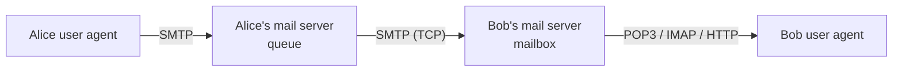

## 3 components
| Component | Role |
|---|---|
| User agent | compose, edit, read (Thunderbird, Outlook) |
| Mail server | **mailbox** (incoming) + **message queue** (outgoing) |
| SMTP | transfer between mail servers (sending server = client, receiving = server) |

## Alice sends a mail to Bob

Push from Alice to Bob's server (servers always on), pull by Bob on demand → [[Mail Access Protocols]]

## SMTP (RFC 821, 1982)
- TCP, port **587** (25 for unsecured), TLS now mandatory (RFC 8314)
- 3 phases : handshaking (greeting) → transfer → closure
- Commands in ASCII, responses = status code + phrase
- Messages in **7-bit ASCII** → [[MIME]]

```
S: 220 hamburger.edu
C: HELO crepes.fr
S: 250 Hello crepes.fr
C: MAIL FROM: <alice@crepes.fr>
S: 250 Sender ok
C: RCPT TO: <bob@hamburger.edu>
S: 250 Recipient ok
C: DATA
S: 354 Enter mail, end with "." on a line by itself
C: Hello World
C: .
S: 250 Message accepted
C: QUIT
S: 221 closing connection
```
Today : `EHLO` + `STARTTLS` → rest encrypted. Try : `telnet servername 25`.

## HTTP vs SMTP
| | HTTP | SMTP |
|---|---|---|
| Direction | **pull** | **push** |
| Both | ASCII command/response, status codes | |
| Content | no restriction | 7-bit ASCII only |
| Objects | one object per response | multiple objects in one multipart message |

**Links** : [[MIME]] [[Mail Access Protocols]] [[Email Security]] [[DNS Records]]
