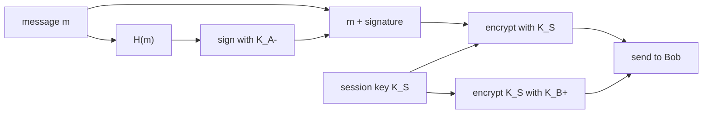

Applies chapter 2 tools to e-mail. Goal = **CIA** : Confidentiality + Integrity + Authentication.

| Goal | Mechanism | Tool |
|---|---|---|
| Confidentiality | m encrypted with session key $K_S$, $K_S$ sent encrypted with $K_B^+$ | [[Session Key]] |
| Integrity | m + digest **H(m + s)** with shared secret s = **MAC** (Message Authentication Code) | [[Hash Functions]] |
| Authentication | digest H(m) signed with Alice's **private** key $K_A^-$ ; Bob compares received and computed digests | [[Public Key Cryptography]] |

## All 3 together (Alice → Bob)

Bob : decrypts $K_S$ with $K_B^-$ → decrypts m + signature → checks the signature with $K_A^+$ → compares H(m).

## PGP (Pretty Good Privacy)
De facto standard for e-mail :
- Confidentiality : IDEA, CAST, 3DES, AES
- Authentication : RSA / ECC signature
- Integrity : MD5, SHA
- Keys certified by **chains of trust** (users vouch for each other, no central CA)

## DKIM (RFC 6376)
Messages signed by the **outgoing SMTP server** ; its public key is published in [[DNS]] → receivers check the mail really comes from that domain.

**Links** : [[Electronic Mail]] [[Certification Authority]] [[Session Key]]
