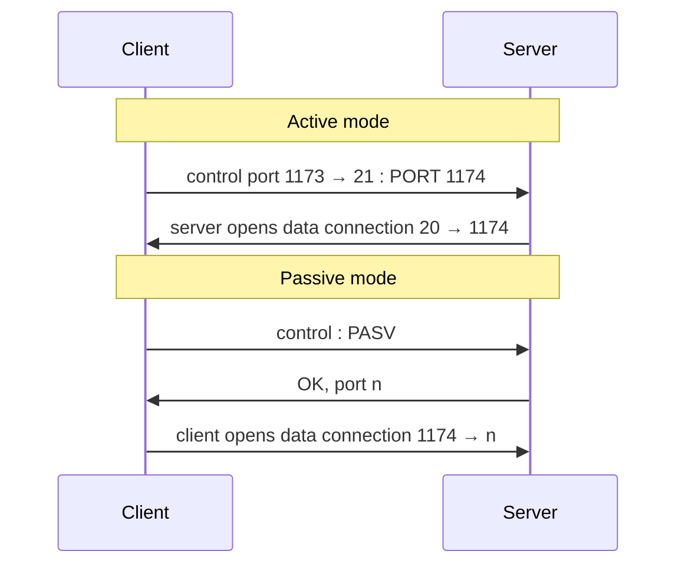

Transfer files to/from a remote host, client/server, RFC 959, server ports **20 and 21**.

## Separate control and data
| Control connection (port 21) | Data connection (port 20) |
|---|---|
| commands + replies, kept open | one per file, closed after each transfer |
| **out of band** (separate from data) | |

- FTP server is **stateful** : current directory, earlier authentication (unlike HTTP)

## Active vs passive mode

Passive mode : the **client** opens the data connection → works behind firewalls / NAT.

## Commands and replies (ASCII on control channel)
| Command | Action | Reply example |
|---|---|---|
| USER / PASS | log in | 331 Username OK, password required |
| LIST | list current directory | 125 data connection open, transfer starting |
| RETR file | get a file | 425 Can't open data connection |
| STOR file | put a file | 452 Error writing file |

## Anonymous FTP
Login `anonymous`, e-mail address as password. Some servers check reverse DNS of the client IP → otherwise `530 access denied`.

## Securing FTP
| FTPS explicit | FTPS implicit | SFTP |
|---|---|---|
| port 21 + `AUTH` command triggers TLS | port 990, TLS from the start | file transfer over SSH |

**Links** : [[HTTP]] [[Socket]]
