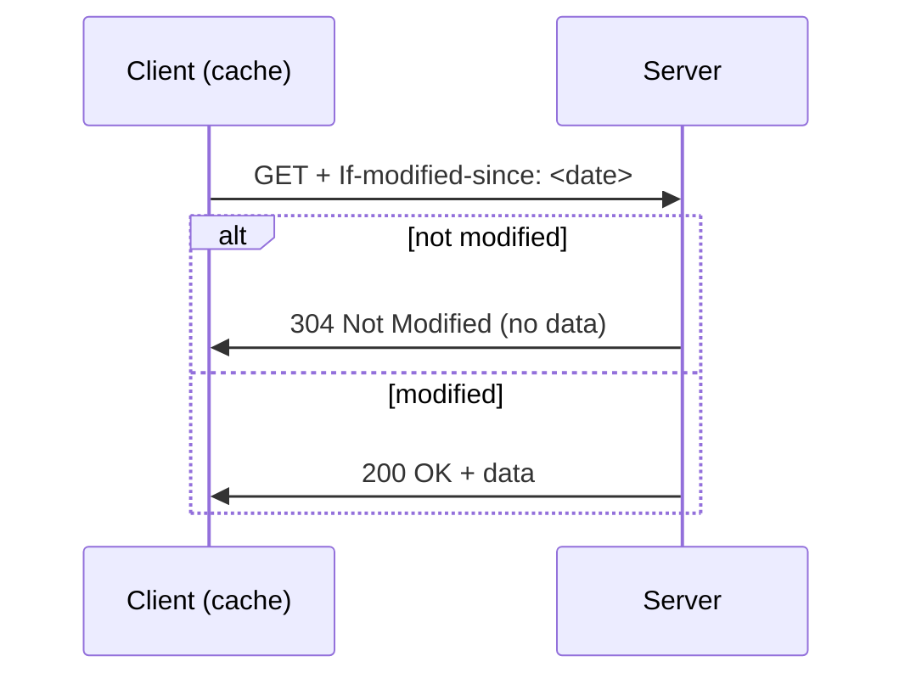
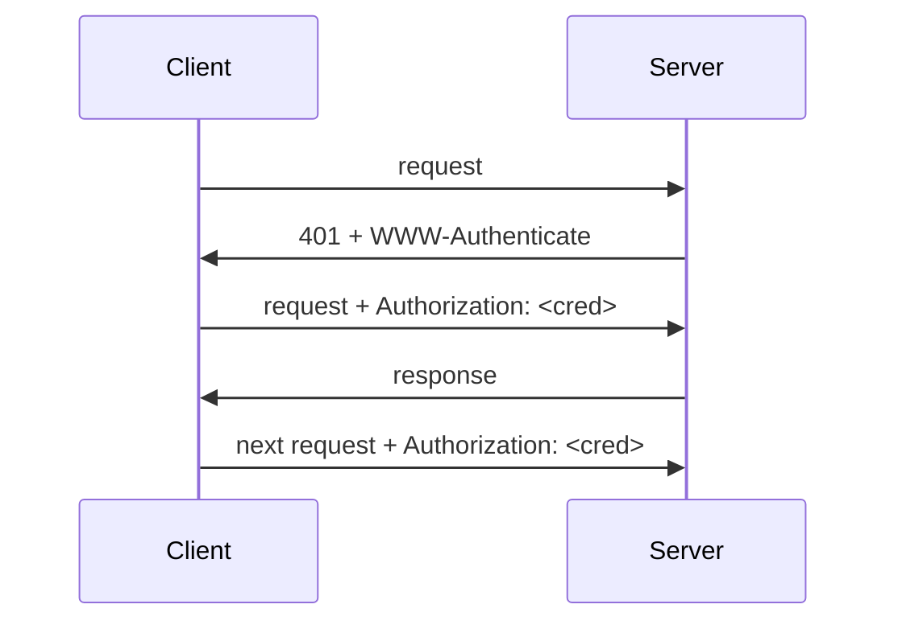

Web's application-layer protocol, client/server, originally over **TCP port 80**.

- Web page = base HTML file + referenced **objects** (images, scripts...) — 2021 average : 68 objects from 10+ hosts, 1.88 MB
- Each object has a **URL** : `www.someschool.edu` (host name) + `/someDept/pic.gif` (path name)
- **Stateless** : the server keeps no memory of past requests → state added with [[Cookies]]
- Also used beyond the Web : REST APIs (familiar, firewall-friendly, reuses caching / security)

## Versions
| | HTTP/1.0 (1996) | HTTP/1.1 (1999) | HTTP/2 (2015) | HTTP/3 (2022) |
|---|---|---|---|---|
| Transport | TCP | TCP | TCP | [[QUIC]] (UDP) |
| Connections | non-persistent | persistent | persistent | connectionless |
| Pipelining | — | FIFO | asynchronous | stream based |
| Headers | ASCII | ASCII | compressed (HPACK) | compressed (QPACK) |
| Issue | | HTTP head-of-line blocking | TCP head-of-line blocking | |

Details on connections → [[HTTP Connections]]

## Messages
```
GET /somedir/page.html HTTP/1.1      <- request line (method, URL, version)
Host: www.someschool.edu             <- header lines
User-agent: Mozilla/5.0
Connection: close
Accept-language: fr
                                     <- empty line = end
```
```
HTTP/1.1 200 OK                      <- status line (version, code, phrase)
Content-Type: text/html              <- header lines
Content-Length: 6821
data data data ...                   <- body
```

## Methods
| Method | Since | Action |
|---|---|---|
| GET | 1.0 | request an object |
| POST | 1.0 | upload form content in the body |
| HEAD | 1.0 | response with header only |
| PUT | 1.1 | upload body to the URL path |
| DELETE | 1.1 | delete the file at the URL |

## Status codes
| Class | Meaning | Example |
|---|---|---|
| 1xx | preliminary, wait for another reply | |
| 2xx | success | 200 OK |
| 3xx | redirection, another action needed | 301 Moved Permanently (URL shorteners) |
| 4xx | client error, may retry later | 404 Not Found |
| 5xx | permanent / server error | 505 HTTP Version Not Supported |

## Conditional GET
Avoid resending an object the client already has in cache.


## Authorisation
Stateless → credentials sent in **every** request.


**Links** : [[HTTP Connections]] [[Cookies]] [[HTTPS and TLS]] [[QUIC]] [[Web Caching]]
