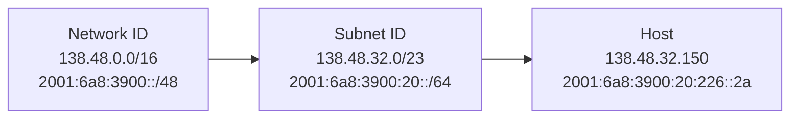

## Address = interface, not host
- An IP address identifies an **interface** (link between a device and a physical link)
- Routers and some hosts have several interfaces → several addresses (**multi-homing**)

| | IPv4 | IPv6 |
|---|---|---|
| Size | 32 bits | 128 bits |
| Notation | decimal : `138.48.32.100` | hexadecimal : `2001:6a8:3900:30::ef` |

## What is an "IP network"?
Interfaces with the **same network part** of the address can reach each other **without a router**.
Example (UNamur) : `138.48.12.0/23` and `2001:6a8:3900:10::/64` = one subnet.

## Prefix and mask
| Address type | Structure |
|---|---|
| IPv4 public (CIDR /m) | network prefix (m bits) + subnet ID (n bits) + host ID (32 − m − n bits) |
| IPv4 private | 10.0.0.0/8, 172.16.0.0/12, 192.168.0.0/16 |
| IPv6 global unicast | 48-bit network prefix + 16-bit subnet = 64-bit prefix, + 64-bit interface ID |
| IPv6 link-local | FE80::/10 + 54 zero bits + 64-bit interface ID |

IPv6 interface ID can be built from the MAC address (**modified EUI-64**) : MAC split in two, `FFFE` inserted in the middle.

## From classes to CIDR
| Class | Leading bits | Networks | Interfaces per network |
|---|---|---|---|
| A | 0 | 2⁷ | 2²⁴ |
| B | 10 | 2¹⁴ | 2¹⁶ |
| C | 110 | 2²¹ | 2⁸ |
| D | 1110 | multicast | |
| E | 11110 | future use | |

Problem : **wasted space** (a class B gives 65 000 addresses even for 2 000 hosts).
→ **CIDR** (Classless InterDomain Routing) : network part of any length, written `a.b.c.d/x` (x = bits of the network part). Routing uses **Longest Match Prefix** (LMP).

## Subnetting

- Subnet hierarchy **invisible** from outside
- Smaller routing tables : outside sees 1 prefix instead of N subnets ; inside routes to subnets, not to machines

## Address types (RFC 4291)
| Type | Delivered to |
|---|---|
| Unicast | one interface |
| Anycast | the **nearest** interface of a set |
| Multicast | **all** interfaces of a set |

Broadcast (255.255.255.255) is replaced by multicast in IPv6.

## Special addresses
| Type | IPv6 | IPv4 |
|---|---|---|
| Unspecified | ::/128 | 0.0.0.0 |
| Loopback | ::1/128 | 127.0.0.1 |
| Multicast | FF00::/8 | 224.0.0.0 – 239.255.255.255 |
| Broadcast / all nodes | FF02::1 | 255.255.255.255 |
| All routers | FF02::2 | — |
| Private / link-local | FE80::/10 | 10/8, 172.16/12, 192.168/16 |

**Links** : [[Route Aggregation]] [[IPv6]] [[IP Forwarding]] [[NAT]] [[DHCP]]
