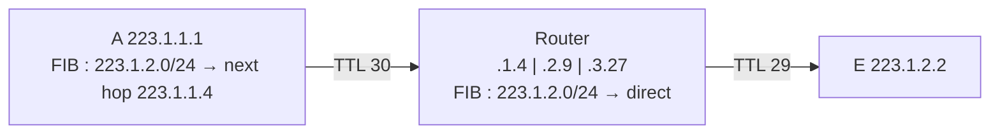

Each host and router looks up the destination in its forwarding table (RIB/FIB) using **Longest Match Prefix** : the most specific matching prefix wins.

## Moving a datagram to its destination
Network : 223.1.1.0/24 (A = .1, B = .3, router = .4), 223.1.2.0/24 (E = .2, router = .9), 223.1.3.0/24.

| Case | Lookup in A | Result |
|---|---|---|
| A → B (223.1.1.3) | B is on the **same network** | link layer sends the datagram **directly** to B |
| A → E (223.1.2.2) | E is on another network | next hop = router **223.1.1.4** |
| at the router | E is directly attached via 223.1.2.9 | link layer delivers to E |

- Source and destination IP **never change** along the path
- **TTL** decremented at each router
- Only the link-layer frame changes at each hop

## Generalised forwarding (match plus action)
In [[Software Defined Networking|SDN]] (OpenFlow), a **flow table** replaces the destination-only table.

| | Traditional forwarding | Generalised forwarding |
|---|---|---|
| Match on | IP destination (LMP) | many fields : 5 layer-2, 4 layer-3, 2 layer-4 (OpenFlow 1.0) |
| Actions | forward | forward (uni / multi / broadcast), **load balance**, **modify fields** (NAT), **drop** (firewall) |

One device can act as router, switch, firewall or NAT depending on its rules.

**Links** : [[IP Addressing]] [[Router Architecture]] [[Route Aggregation]] [[Software Defined Networking]]
