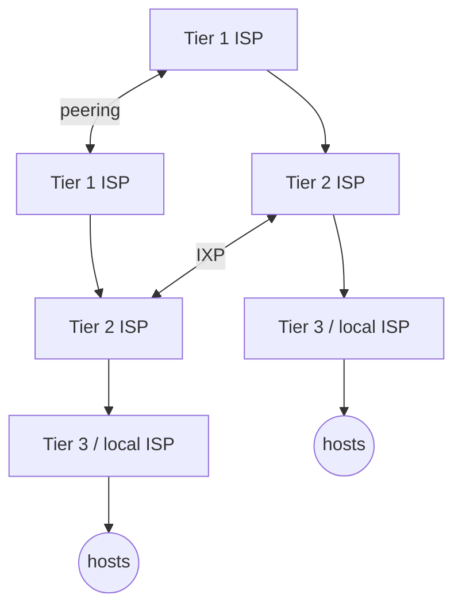

Traditional view (1990s) : access networks at the edge connect to the rest of the Internet through a **tiered hierarchy** of Internet Service Providers (ISPs).

| Tier | Role |
|---|---|
| Tier 1 | National/international coverage, directly connected to **all** other tier-1 ISPs (**peering**, paid or free = Settlement Free Interconnection) |
| Tier 2 | Smaller, often regional. **Customer** of tier-1 ISPs (pays for connectivity) |
| Tier 3 / local | Customer of higher tiers, last hop ("access") network, closest to hosts |

Arrows down = provider → customer (the customer pays).

- ISPs can interconnect at **IXPs** (Internet eXchange Points), e.g. BNIX in Belgium
- Examples : GÉANT (European research backbone), Belnet (Belgian research network)

## Today : a flatter, highly interconnected Internet
- More direct connections between providers → **IXPs**
- More efficient content distribution → **CDN** (Content Distribution Network) : content placed close to the users

**Links** : [[What is the Internet]] [[Network Access]]
