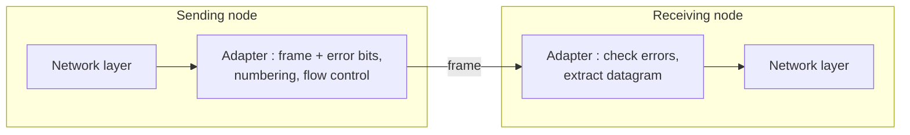

Link layer = move a datagram from one node to an **adjacent** node over a link.

| Term | Meaning |
|---|---|
| Node | host, router, bridge, switch |
| Link | channel between adjacent nodes |
| **Frame** | layer-2 PDU, encapsulates the datagram |

A datagram crosses **different links with different protocols** (e.g. EPON → Ethernet → WiFi), each with its own services.

Analogy (trip Princeton → Lausanne) :
| Trip | Network |
|---|---|
| tourist | datagram |
| segment (car, plane, train) | link |
| transport mode | link-layer protocol |
| travel agent | routing algorithm |

## Two sublayers
| LLC — Logical Link Control | MAC — Medium Access Control |
|---|---|
| independent of the medium | specific to the physical layer |
| **framing** : datagram → frame | **link access** : none on point-to-point, arbitration on broadcast links |
| **physical (MAC) address** in the header (≠ IP) | |

## Services
| Service | Note |
|---|---|
| Framing, link access | see above |
| Reliable delivery | ACK + retransmission (Go-Back-N, Selective Repeat) ; rare on low-error links (fiber), useful on **wireless** (fix locally, not end to end) |
| **Error detection** | errors from attenuation and noise ; detect → drop or retransmit ; in **hardware** |
| Error correction | fix bit errors without retransmission |
| Flow control | between adjacent nodes |
| Half / full duplex | can a node send and receive at the same time? |

Same ideas as the transport layer, but **node to node**, not end to end.

## Where it is implemented : the adapter (NIC)

| Software (CPU) | Hardware (NIC chip) |
|---|---|
| high level : frame addressing, interrupts | low level : framing, medium access, flow control, error detection |

The adapter is **semi-autonomous** : it can drop a bad frame without telling the upper layers.

**Links** : [[Error Detection]] [[Multiple Access Protocols]] [[MAC Address and ARP]] [[Ethernet]] [[Reliable Data Transfer]]
