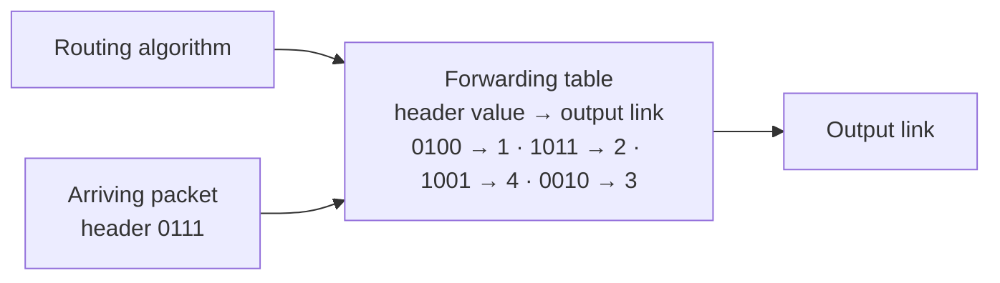

Network layer = carry packets from the sending host to the receiving host. It runs in **every host and every router** (unlike the transport layer, only in end systems).

## 3 functions
| Function | What | Scope |
|---|---|---|
| **Forwarding** | move a packet from the router's input to the right output, using the forwarding table | local (one router) |
| **Routing** | compute the route from source to destination (fills the forwarding tables) | global (whole network) |
| Call setup | prepare the path before data (virtual circuits only) | |

Analogy : routing = planning the trip on a map, forwarding = choosing the exit at one interchange.

## Service models
What can the network promise between two edges? Loss-free, in-order, minimum bandwidth, no jitter (timing), congestion feedback.

| Architecture | Service model | Bandwidth | No loss | In order | Timing | Congestion feedback |
|---|---|---|---|---|---|---|
| Internet | best effort | no | no | no | no | no (inferred from loss) |
| ATM | CBR | constant, guaranteed | yes | yes | yes | no congestion |
| ATM | VBR | variable, guaranteed | yes | yes | yes | no congestion |
| ATM | ABR | guaranteed minimum | no | yes | no | yes |
| ATM | UBR | none | no | yes | no | no |
| Internet evolutions | IntServ / DiffServ | | | | | |

The basic Internet offers a **single** service : [[Best Effort]].

## Internet vs ATM
| Internet (datagram) | ATM (virtual circuit) |
|---|---|
| data between computers | evolved from telephony (PSTN), conversation between humans |
| elastic service, no strict timing | needs guaranteed service |
| complexity at the **edge** (smart end systems) | complexity **inside** the network (dumb end systems) |
| commoditisation (bit pipe) | services generate revenue |

## Virtual circuit vs datagram at the network layer
| | Virtual circuit | Datagram |
|---|---|---|
| Service | connection-oriented | connectionless |
| Phases | VC setup → data transfer → teardown | none, send directly |
| Packet carries | VC identifier | destination address |
| Router state | per connection, resources may be reserved | none |
| Setup involves | **all routers** on the path (signalling) | — (≠ TCP handshake, only end systems) |
| Examples | legacy ATM, Frame Relay, X.25 ; today **MPLS** | best-effort Internet |

Details → [[Virtual Circuit networks]] and [[Datagram networks]].

**Links** : [[Router Architecture]] [[Routing Algorithms]] [[Packet Switching]] [[Transport Layer Services]]
