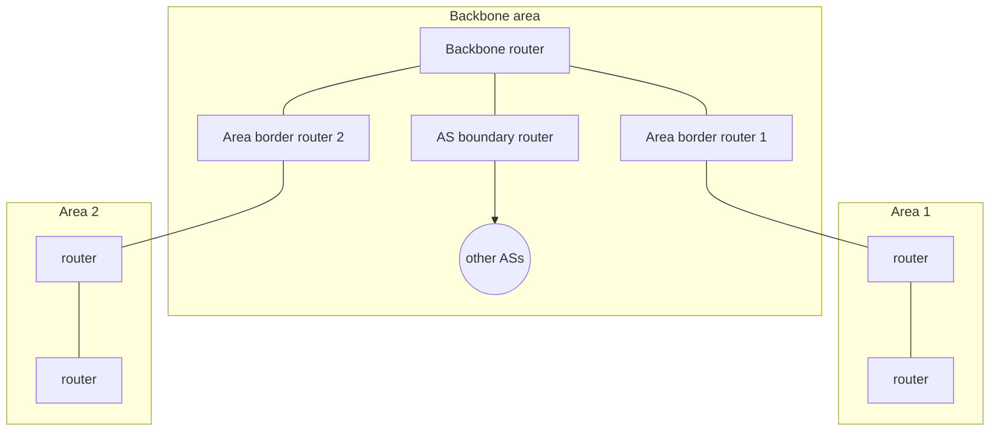

Intra-AS protocol based on **link state**, successor of [[RIP]].
- Link state information **flooded** to the entire AS
- Each router runs [[Dijkstra Algorithm|Dijkstra]] → shortest path tree → routing table
- Messages carried **directly over IP** (protocol 89), not over TCP or UDP

## OSPF vs RIP
| | RIP | OSPF |
|---|---|---|
| Algorithm | distance vector | link state (Dijkstra) |
| Link cost | always 1 (hops) | **policy** : 1 (= RIP), inverse of capacity, ... |
| Transport | UDP 520 | IP directly (protocol 89) |
| Security | none | all messages **authenticated**, only trusted routers |
| Equal-cost paths | one path chosen | **several** allowed (load sharing) |
| Multicast | no | integrated (MOSPF, same topology database) |
| Hierarchy | no | **areas** |

## Hierarchy with areas

- Each area runs OSPF **internally**, its structure is invisible from outside
- **Area border routers** route packets out of the area
- The **backbone area** carries traffic between areas and to other ASs

> The intra vs inter-AS slide writes "OSPF (TCP 89)" : 89 is the IP protocol number, OSPF does not use TCP.

**Links** : [[Dijkstra Algorithm]] [[RIP]] [[Autonomous Systems]] [[BGP]]
