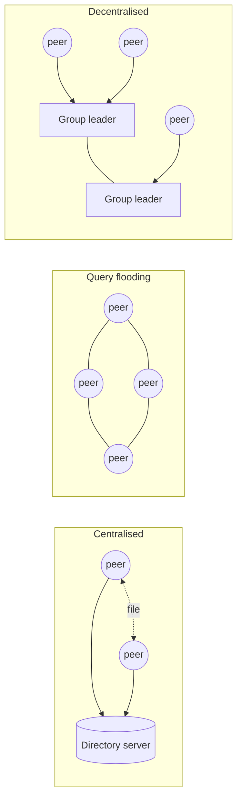

IAB definition (RFC 5694) : the elements **share their resources** and **both provide and request** services.
- Uses : file sharing, distributed computing, collaboration (Skype, IM), platforms (JXTA)
- SETI@home is **not** P2P : requests generated by a central master

## File sharing scenario
Alice connects intermittently (new IP each time), asks for a file, downloads it from Bob, and meanwhile others download from her → each peer is a client **and** a transient server.

## Overlay network
Virtual network of peers on top of the Internet : peers = nodes, edges = virtual links. A new peer joins through a **bootstrap node**.

## 3 architectures

| | Centralised directory | Query flooding | Decentralised directory |
|---|---|---|---|
| Examples | Napster, BitTorrent | Gnutella (≤ 0.4) | Kazaa, eDonkey, Gnutella2 |
| Locating content | central server | query forwarded to neighbours, "query hit" sent back | ask group leader (super-peer), leaders ask each other |
| Pros | simple | fully decentralised, all peers equal | no central server, hard to shut down |
| Cons | **SPOF**, bottleneck, legal target | excessive query traffic, limited query radius | complex, leaders overloaded |
| Overlay | none | yes (bootstrap, churn) | yes |
| Scalable | no | no | **yes** |

## BitTorrent swarming
Collect **chunks** of a file from many peers instead of the whole file from one.
- **Publish** : a `.torrent` file (chunk hashes) + a tracker
- **Join** : get the list of peers from the tracker
- **Fetch** : download/upload chunks between peers
- **Seed** = peer holding the whole file

## Trends
- P2P = 45–70 % of traffic in 2008 ; BitTorrent 31 % → 3 % (2008 → 2016, USA)
- Replaced by **OTT streaming** (Netflix...)
- Fediverse (Mastodon, PeerTube, ActivityPub) : decentralisation through **interoperability**

**Links** : [[The Network edge]] [[Content Distribution Network]] [[Hash Functions]]
