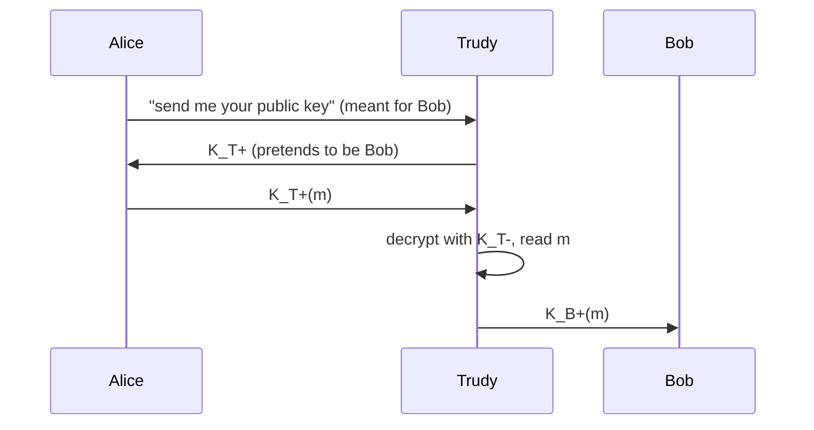

Trudy sits between Alice and Bob and impersonates each of them with **her own key pair** : she decrypts, reads and re-encrypts everything (Alice and Bob may only find out later).

- Root cause : nothing proves that a public key really belongs to its claimed owner
- Solution : a **Trusted Third Party (TTP)**

| | Symmetric key | Public key |
|---|---|---|
| Issue | how to share a secret key? | how to securely get a public key? |
| TTP | [[Key Distribution Center]] (KDC) | [[Certification Authority]] (CA) |

**Links** : [[Session Key]] [[Public Key Cryptography]]
