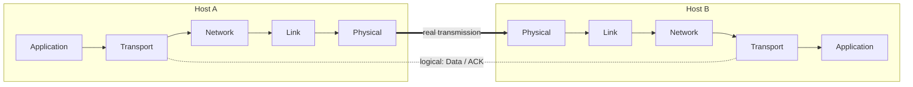

Networks are complex (hosts, routers, links, apps, protocols, HW, SW) → organise them in **layers**.

## Principle (air travel analogy : ticket → baggage → gate → runway → routing)
- Each layer implements a service
- via its own internal actions
- relying on the services of the layer below

## Why layering?
- Abstraction : explicit structure to identify and relate the pieces (reference model)
- Modularity : changing one layer's implementation is transparent to the rest
- But "layering considered harmful?" (overhead, duplicated functions)

## Encapsulation
Each layer takes data from above, **adds a header**, and passes the new unit (PDU) to the layer below.

| Layer | Unit | Content |
|---|---|---|
| Application | message | `M` |
| Transport | segment | `Ht │ M` |
| Network | datagram | `Hn │ Ht │ M` |
| Link | frame | `Hl │ Hn │ Ht │ M` |
| Physical | bits | 0101... |

Receiver side = reverse (decapsulation) : each layer removes its own header.

## Logical communication
Each layer is distributed : entities in each node exchange messages with their **peers** of the same layer (e.g. transport Data / ACK).

**Links** : [[Internet Protocol Stack]] [[OSI Model]] [[What is a Protocol]]
