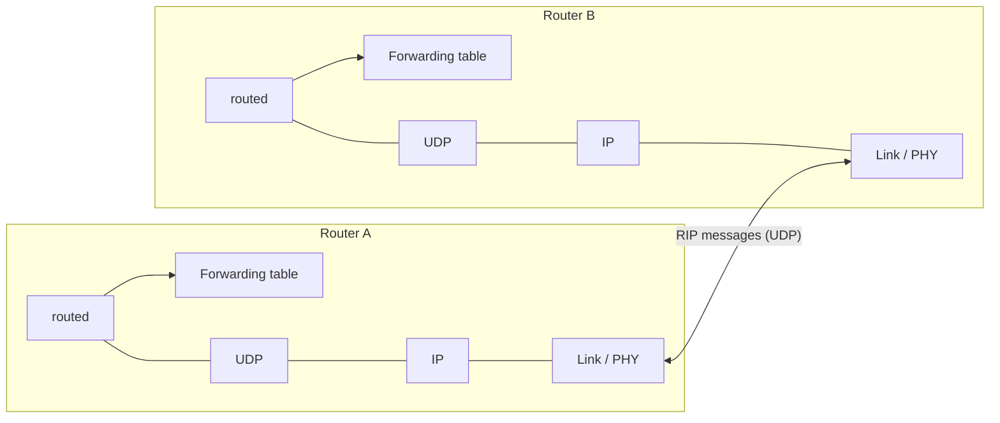

Intra-AS protocol based on [[Distance Vector|distance vector]].

| Feature | Value |
|---|---|
| Metric | number of hops (each link cost = 1), **max 15** → only for ASs < 15 hops wide |
| Advertisements | every **30 s**, up to 25 destination networks with their distance |
| Neighbour declared dead | no advertisement for **180 s** → routes via it invalidated, new advertisements sent |
| Loops | **poisoned reverse** (16 hops = infinity) |
| Transport | UDP, port 520 |

Failure information propagates quickly to the whole network.

## Implementation
A daemon **`routed`** runs RIP at the **application layer** and updates the forwarding table of the network layer.

## Example table
- Router with 3 attached class C LANs (interfaces fa0, le0, qaa0) only knows routes to them
- **Default router** 193.55.114.129 used to "go up"
- Also : multicast 224.0.0.0, loopback 127.0.0.1
- Flags : U = up, G = gateway, H = complete host address

**Links** : [[Distance Vector]] [[OSPF]] [[Autonomous Systems]]
