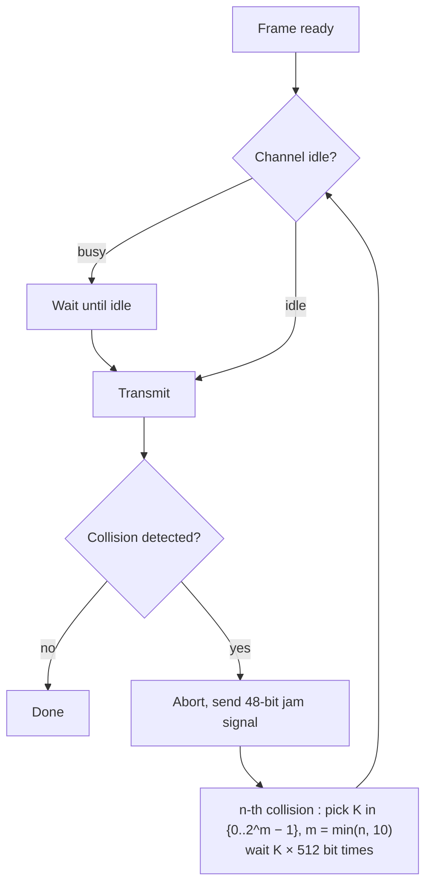

A node with a frame sends at the **full rate R**, with no prior coordination. Two senders → **collision**. The protocol says how to **detect** collisions and how to **recover** (delayed retransmission).

## Overview
| Protocol | Listen before? | Detect collision? | Max efficiency |
|---|---|---|---|
| Pure ALOHA (Hawaii, 1971) | no, send at once | no | **18 %** |
| Slotted ALOHA | no, wait for next slot | yes (end of slot) | **37 %** (1/e) |
| CSMA | **yes** | no | depends on propagation delay |
| CSMA/CD (Ethernet) | yes | **yes, abort** | → 1 when t_prop → 0 |
| [[CSMA-CA\|CSMA/CA]] (WiFi) | yes | no, **avoid** + ACK | |

Human analogy : ALOHA = boorish partygoer, CSMA = conversation, CSMA/CD = polite conversation.

## Slotted ALOHA
Assumptions : same frame size L, slots of L/R seconds, nodes synchronised, send only at slot start.
- New frame → send in next slot
- Collision → retransmit in each following slot **with probability p** until success

| Pros | Cons |
|---|---|
| simple, highly decentralised | collisions waste slots |
| one active node uses the full rate | idle slots when nodes hold back |
| | needs synchronisation |

**Efficiency** (N nodes, each sends with probability p) :
- success of one node : p(1−p)^(N−1)
- success of any node : Np(1−p)^(N−1), maximum for **p\* = 1/N**
- N → ∞ : max efficiency = **1/e ≈ 0.37** → useful transmissions only 37 % of the time

**Pure ALOHA** : no slots, a frame sent at t0 collides with any frame sent in [t0−1, t0+1] → twice the vulnerable period → **≤ 18 %**.

## CSMA (Carrier Sense Multiple Access)
Listen first : idle → send the whole frame ; busy → defer.
Collisions still happen : because of **propagation delay**, a node may not hear a transmission that has already started. The whole frame time is then wasted.

## CSMA/CD (Collision Detection)

- Easy in wired LANs (compare sent and received signal), hard in wireless
- **Binary exponential backoff** : the more collisions, the bigger the range for K → adapts to the number of active nodes
- 1 bit time = 0.01 µs at 100 Mbps

## Ethernet CSMA/CD efficiency
$$\text{Efficiency} = \frac{1}{1 + 5\, t_{prop} / t_{trans}}$$
→ 1 when t_prop → 0 (close nodes, collisions detected fast) or t_trans → ∞ (long frames). Much better than ALOHA, still simple and decentralised.

**Links** : [[Multiple Access Protocols]] [[CSMA-CA]] [[Ethernet]]
