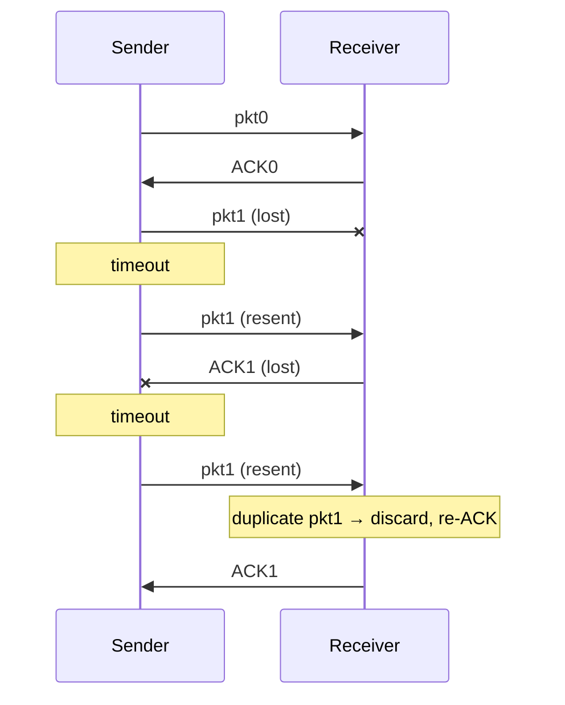

How to build a reliable transfer (**rdt**, fictional protocol) on top of an unreliable channel. The worse the channel, the more mechanisms are needed. Described with **finite state machines** (FSM) : state + event → actions → next state.

## Building it step by step
| Version | Channel | New mechanism | Why |
|---|---|---|---|
| rdt1.0 | perfectly reliable | nothing | sender sends, receiver reads |
| rdt2.0 | bit errors | checksum + **ACK / NAK** + retransmission | detect and repair errors (dictation analogy) |
| rdt2.1 | bit errors, ACK/NAK may be corrupted | **sequence number** (1 bit : 0/1) | sender retransmits if feedback is corrupted, receiver drops duplicates |
| rdt2.2 | same | **numbered ACK** instead of NAK | duplicate ACK = NAK → retransmit |
| rdt3.0 | bit errors **and losses** | **countdown timer** | if no ACK in time → retransmit |

- Protocols based on retransmissions = **ARQ** (Automatic Repeat reQuest)
- rdt2.0+ wait for each ACK before sending the next packet = **Stop-and-Wait (SAW)**
- rdt3.0 with 1-bit sequence number = **alternating-bit protocol**

## rdt2.0 fatal flaw
If the ACK/NAK itself is corrupted, the sender can't know what happened. Retransmitting may create a **duplicate** → solution : sequence numbers.

## rdt3.0 in action

4 cases : no loss, lost packet, lost ACK, premature timeout (packet only delayed) — sequence numbers handle the duplicates.

**Links** : [[Pipelined Protocols]] [[UDP]] [[TCP Reliable Data Transfer]]
