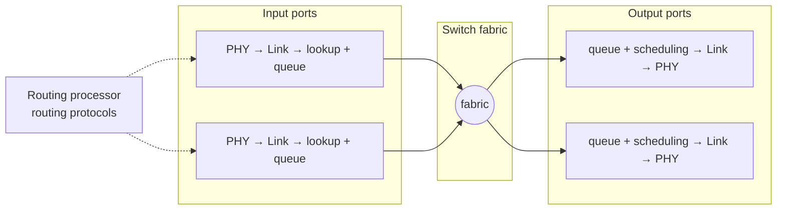

Two key functions : **routing** (run RIP, OSPF, BGP → control plane) and **forwarding** (switch datagrams from input to output link → data plane).

## Input ports
- Physical layer (bit reception) → link layer (e.g. Ethernet) → network layer
- **Decentralised switching** : each input port has a copy of the forwarding table and looks up the output port itself
- Goal : work at **line speed** — lookup time < transmission time (64-byte packet at 100 Gbps = **5 ns**)
- Lookup techniques : linear search, binary tree (32 levels IPv4, 128 IPv6), **CAM** (Content Addressable Memory, the address indexes the table), caching
- Queueing if datagrams arrive faster than the fabric can take them

## Switch fabrics
| Type | How | Limit |
|---|---|---|
| Memory | packet copied into processor memory, then to the output (classic PC) | memory speed |
| Bus | direct input → output over one shared bus | one packet at a time, bus speed |
| Interconnection network (crossbar) | 2N buses for N inputs and N outputs | still blocking if a vertical bus is busy |

## Output ports
- **Queueing** when the fabric delivers faster than the outgoing link rate
- **Scheduling** : which queued datagram goes next
- Then link layer and physical layer

## Where packets queue
| Output queueing | Input queueing |
|---|---|
| fabric N times faster than lines → many inputs to the same output | fabric not fast enough |
| buffer full → loss (**drop tail**) | **head-of-line (HOL) blocking** : the packet at the front blocks the ones behind, even if their output is free |

## Random Early Detection (RED)
Drop **before** the buffer is full, to signal congestion early to TCP sources.

| Average queue size | Action |
|---|---|
| < min_th | no drop |
| between min_th and MAX_th | drop with probability rising from 0 to MAX_p |
| > MAX_th | drop |

Two steps : estimate the average queue size, then decide to drop or not.

**Links** : [[Network Layer Services]] [[Queueing Delay]] [[Packet Loss]] [[Congestion Control Principles]] [[IP Forwarding]]
