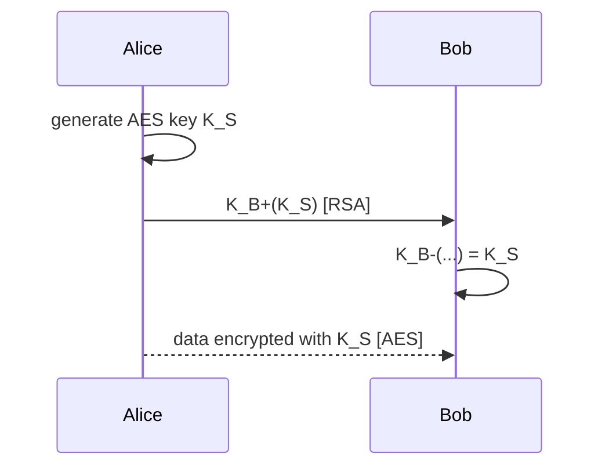
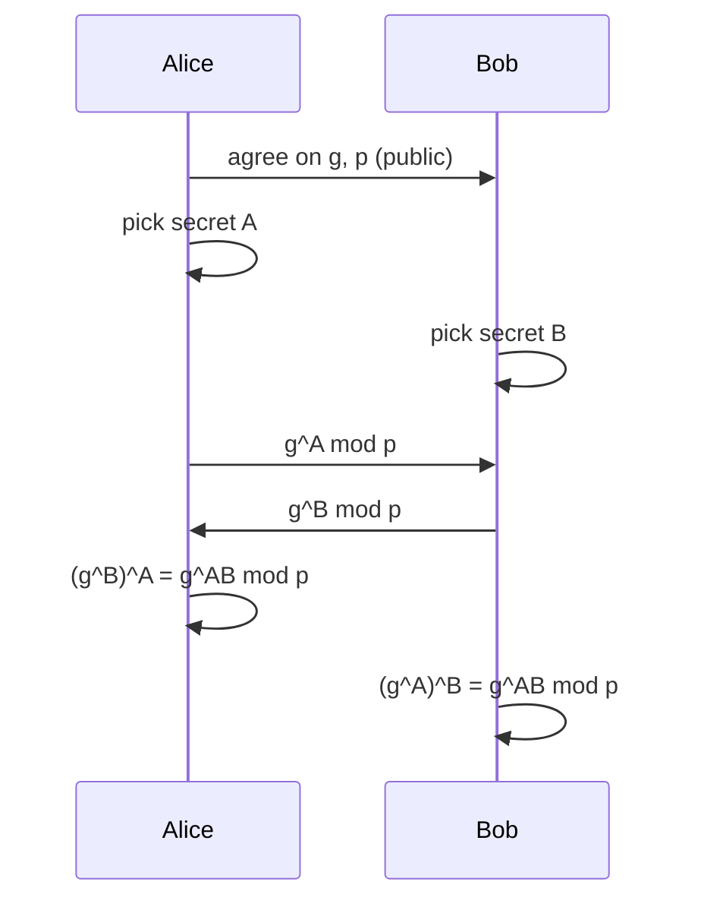

Best of both worlds : public key to agree on a key, then fast symmetric encryption ([[AES]]) with this **session key** $K_S$.

## Mixed scheme
1. Alice generates an AES key $K_S$
2. She encrypts it with Bob's public key $K_B^+$ ([[RSA]])
3. Bob decrypts it with $K_B^-$ → both share $K_S$

## Diffie-Hellman
1. Alice and Bob agree (publicly) on g and p
2. Alice picks random A, sends $g^A \bmod p$ ; Bob picks random B, sends $g^B \bmod p$
3. Each computes $(g^B)^A = (g^A)^B = g^{AB} \bmod p$ → shared key

- Security : given g, p and $g^X \bmod p$, guessing X is hard (discrete logarithm)
- ⚠️ No authentication → vulnerable to [[Person in the middle attack]]

**Links** : [[Symmetric Key Cryptography]] [[Public Key Cryptography]]
