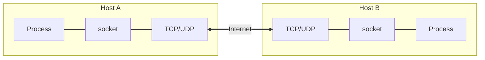

**Socket** = interface (API) between the application and the transport layer within a host. Analogy : a **door** — the process pushes the message out, the transport infrastructure carries it to the other door.

- Controlled by the app developer : the process + choice of transport protocol + some parameters (buffer size, segment size)
- Controlled by the OS : everything below the socket

## Addressing a process
IP address alone is not enough (many processes on the same host) → identifier = **IP address + port number**

| Service | Server port |
|---|---|
| HTTP / HTTPS | 80 / 443 |
| FTP | 20 (data), 21 (control) |
| SMTP | 25 / 587 (sending) |
| POP3 | 110 |
| DNS | 53 |

Client side : **ephemeral** port (random, > 1024).

## UDP vs TCP sockets (review question)
- UDP server : 1 socket for all clients
- TCP server : 1 "welcoming" socket + 1 socket per connection → N simultaneous connections = N + 1 sockets

> The last section is completed from general knowledge (answer to the review question).

**Links** : [[Application Layer Protocol]] [[The Network edge]]
