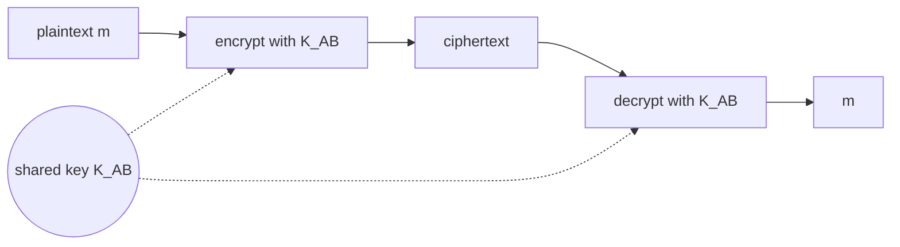

Alice and Bob share the **same key** $K_{A-B}$ (seed of the substitution pattern).

Main problem : how do they agree on the key? → [[Session Key]], [[Key Distribution Center]]

## Classical examples (substitution)
| Cipher | Principle | Key space | Weakness |
|---|---|---|---|
| Caesar | shift each letter by k positions | 25 | trivial brute force |
| Monoalphabetic | any letter → any letter, no pattern | 26! ≈ 4·10²⁶ | **statistical analysis** (letter frequency) |
| Polyalphabetic | several ciphers used in turn (e.g. Caesar 5 / 19 with pattern C1 C2 C2 C1 C2) | larger | pattern repeats |
| Enigma (WWII) | substitution changes at **each character** (rotors) | ~1.6·10²⁰ settings | — |

## Modern algorithms
- [[DES]] (and 3-DES), [[AES]]
- Others : RC2, RC4 (prohibited, RFC 7465), RC5, RC6, IDEA, CAST, ChaCha20
- Common method : split plaintext in N-bit blocks, repeat key-dependent operations (substitution, permutation, XOR)
- Fast, based on substitutions & permutations

**Links** : [[Public Key Cryptography]] [[Computational Security]]
