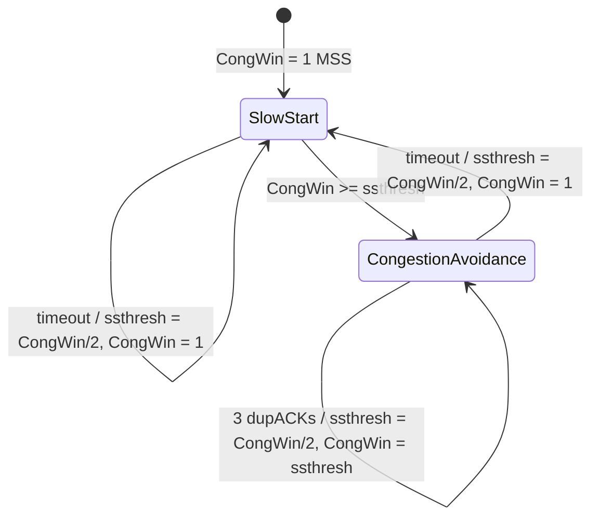

End-to-end : the sender keeps a **congestion window** CongWin.
- $LastByteSent - LastByteAcked \leq CongWin$ → rate ≈ CongWin / RTT
- **Loss event** = timeout **or** 3 duplicate ACKs → reduce CongWin

## 3 mechanisms
| Mechanism | Rule |
|---|---|
| **Slow start** | start at 1 MSS, **double** every RTT (exponential) until threshold or loss |
| **Additive increase** (congestion avoidance) | +1 MSS every RTT (linear) |
| **Multiplicative decrease** | cut CongWin in half after loss |

Slow start example : MSS = 500 B, RTT = 200 ms → initial rate only 20 kbps, so grow fast. Initial window : 2–4 MSS (RFC 3390), 10 MSS (RFC 6928).

## Reaction to loss
| Event | Meaning | ssthresh | CongWin | Then |
|---|---|---|---|---|
| 3 dupACKs | network still delivers some segments | CongWin / 2 | = ssthresh (half) | linear growth |
| Timeout | "more alarming" | CongWin / 2 | **1 MSS** | slow start up to ssthresh, then linear |

Result : the famous **sawtooth** of CongWin over time.

Review question : on timeout, **ssthresh = CongWin / 2** (CongWin just before the loss) and CongWin restarts at 1 MSS.

## Bandwidth-Delay Product (BDP)
**BDP = bandwidth × delay** = capacity of the "pipe" = data in flight needed to fill it. **Self-clocking** : each ACK means one segment left the network → send a new one.

| Access | Bandwidth | Delay | BDP |
|---|---|---|---|
| Ethernet | 100 Mbps | 3 ms | 36.6 KiB |
| Transcontinental fiber | 1 Gbps | 60 ms | 7.2 MiB |
| Satellite | 1.5 Mbps | 500 ms | 91.6 KiB |

## Modern variants
| | Standard (Reno) | CUBIC (RFC 8312) | BBR (Google, 2016) |
|---|---|---|---|
| Congestion signal | loss | loss | **measured** bandwidth and RTT |
| Growth | linear | **cubic** function | pace at bottleneck rate |
| Fixes | | low use of large-BDP links | loss no longer means congestion |
| Where | | Linux (2006), macOS, Windows 10 | Linux, QUIC |

BBR aims at : arrival rate = bottleneck bandwidth (BtlBw) **and** data in flight = BDP = BtlBw × RTprop.

## TCP history
Tahoe (slow start, congestion avoidance, fast retransmit) → Reno (+ fast recovery) → NewReno, SACK, Vegas, Westwood...

**Links** : [[Congestion Control Principles]] [[TCP Fairness]] [[TCP Latency Model]] [[TCP Reliable Data Transfer]] [[TCP Flow Control]]
